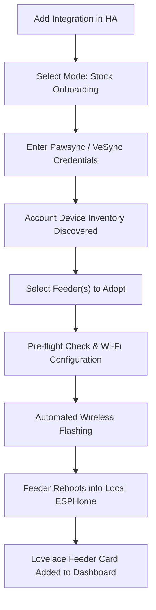

# PawSync Feeder Home Assistant Onboarding Guide

This guide walks you through the guided onboarding process for the **Pawsync PPF-R361S Smart Pet Feeder** into Home Assistant.

> [!CAUTION]
> ### ⚠️ COMMUNITY TESTING NOTICE
> This project is in public community testing. The authors take **no responsibility** for bricked devices or damaged hardware. Before flashing custom firmware for the first time, **we strongly recommend performing a 4MB hardware flash backup via a 3.3V USB-UART adapter** so you can always restore your device if anything goes wrong. See [Teardown & Backup Guide](README.md#-hardware-teardown-uart-pinout--flash-backuprestore-guide).

---

## Overview

The `pawsync_esphome` integration provides an interactive, zero-terminal adoption wizard directly inside the Home Assistant user interface.



---

## Step-by-Step Walkthrough

### Step 1: Install the Integration
1. Open Home Assistant.
2. In **HACS** (Home Assistant Community Store):
   - Go to **Integrations** -> **Custom repositories** (three dots in top right).
   - Enter repository URL: `https://github.com/sibero80/pawsync_esphome`
   - Category: **Integration**
   - Click **Add**, then find **PawSync Smart Pet Feeder** and click **Download**.
3. Restart Home Assistant when prompted.

---

### Step 2: Launch the Onboarding Wizard
1. In Home Assistant, go to **Settings** -> **Devices & Services** -> **Add Integration**.
2. Search for **PawSync Smart Pet Feeder** and select it.
3. You will be presented with two onboarding modes:
   - **Guided Onboarding for Stock Feeder (Pawsync Cloud)**: Select this if your feeder is running the factory stock firmware.
   - **Direct Adoption of Flashed ESPHome Feeder (Local IP)**: Select this if your feeder is already running ESPHome and you just want to add it by IP address.

---

### Step 3: Account Authentication
1. Enter your **Account Email** and **Password** (the same credentials used in the Pawsync or VeSync mobile app).
2. Select your **Country / Region** (e.g. `US`, `CO`, `ES`, `CA`, etc.).
3. Click **Submit**.

> **Privacy Note:** Your account credentials are used strictly during this one-time step to query the cloud API and obtain your feeder's hardware Client ID (`cid`) and MAC address. Once adopted, all communication is 100% local over your LAN. No cloud account is required afterwards.

---

### Step 4: Multi-Feeder Selection
1. The integration will query your account and display all detected pet feeders.
2. Each feeder is listed with its nickname, model (`PPF-R361S`), and hardware MAC address:
   ```
   [x] Living Room Feeder (VS_WB_PFM_PPF-R361S-WUS_US) - MAC: 10:97:BD:XX:XX:XX
   ```
3. Select the feeder you want to adopt and click **Submit**.

---

### Step 5: Pre-Flight Check & Wi-Fi Setup
1. Enter your home 2.4GHz Wi-Fi **SSID** and **Password**.
   - These credentials will be provisioned into the local firmware so the feeder reconnects seamlessly to your local network after conversion.
2. Confirm that the feeder is powered on and within reliable Wi-Fi range of your router.
3. Click **Submit**.

---

### Step 6: Flashing Method Selection
Choose your preferred installation method:
1. **Automated Wireless OTA Flashing (Zero-Touch)** *(Recommended)*:
   - Home Assistant spins up an internal, paced HTTP staging server on port 8000.
   - Sends a secure command through the cloud relay instructing the feeder to download the local ESPHome firmware directly from your Home Assistant server.
   - The feeder flashes its partition over the air and reboots into local ESPHome mode within ~60 seconds.
2. **Browser WebSerial / USB-C Cable**:
   - For users who prefer a direct wired connection using a USB-C data cable.
3. **Skip Flashing**:
   - For devices that have already been converted manually.

---

### Step 7: Automated Adoption & Device Registration
1. Once the flash command is dispatched, Home Assistant registers the feeder in your **Device Registry** under **PawSync**.
2. As soon as the feeder boots into ESPHome, the integration automatically completes the ESPHome handshake in the background:
   - Sets up the encrypted native API connection using a unique, cryptographically generated 32-byte Noise PSK.
   - Saves all device credentials into `/config/esphome/secrets.yaml` under MAC-scoped keys (`feeder_<mac>_*`) with strict mode `0600` permissions.
   - Registers all entities with zero manual intervention required.
3. If Home Assistant ever prompts you manually for the device's encryption key, you can find the unique per-device Noise PSK saved under `feeder_<mac>_noise_psk` in your `/config/esphome/secrets.yaml` or view it in the integration entry's device card.

---

### Step 8: Lovelace Feeder Card Setup
The custom Lovelace Feeder Card (`pawsync-feeder-card.js`) is automatically registered by the integration:
1. Open any dashboard in Home Assistant.
2. Click **Edit Dashboard** -> **Add Card**.
3. Search for **PawSync Feeder Card** (or add a **Manual** card with `type: custom:pawsync-feeder-card`).
4. The card will automatically detect all configured feeders and display the live stainless steel bowl scale, 7-plan schedule manager, and quick manual dispensing wheel!

*(Note: If your browser displays "Custom element doesn't exist", do a hard refresh with **Ctrl+Shift+R** or add `/local/pawsync-feeder-card.js` as a JavaScript Module in Settings -> Dashboards -> Resources).*
