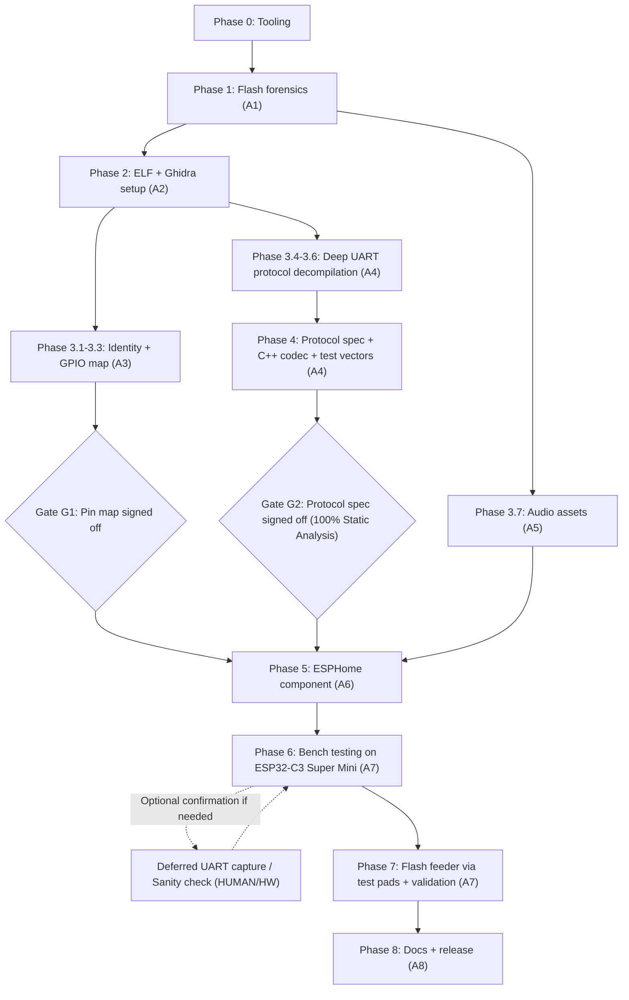

# PPF-R361S → ESPHome Porting Plan (Multi-Agent Execution Plan)

> **Audience:** autonomous agents (and humans) that will do the reverse engineering and the ESPHome port.
> **Inputs in repo (`/root/pawsync2`):**
> - `esp32c3_dump.bin` – raw 4 MiB SPI flash dump of the ESP32-C3-SOLO-1 (`U10`). **Read-only. Never modify.**
> - `Argon.md` – hardware ground truth (PCB markings, dual-MCU architecture, NS4168 audio amp, pinout, first-pass workflow).
> - `ESP_Manual.md` – ESP32-C3-SOLO-1 module manual (pin table, flashing basics).
> - `Pawsync_manual.md` – end-user manual of the feeder (defines the feature set we must reproduce).
>
> **Goal:** 100 % local ESPHome firmware for the ESP32-C3 exposing every device feature to Home Assistant, with **zero changes to the SC95F8766P MCU firmware** and a guaranteed rollback path to stock.

---

## 0. Read This First – Critical Corrections & Open Hypotheses

| # | Item | Status | Consequence for agents |
|---|---|---|---|
| C1 | `Argon.md` calls the device a **Petlibro**. It is a **Pawsync PPF-R361S-WUS** (Pawsync = Arovast/**VeSync** brand, app "Pawsync", BLE provisioning). | **CONFIRMED by owner** (2026-10-21). Ignore every "Petlibro" reference in `Argon.md`. Phase 1 still records the exact VeSync SDK/module strings. | The UART protocol is most likely the **VeSync ESP↔MCU protocol** (same family as Levoit air purifiers/humidifiers), *not* Tuya. Use VeSync/Levoit community knowledge as the **primary hypothesis** (§3.6), but confirm every opcode for this model. Component name stays `ppf_r361s` (model-specific, brand-neutral). |
| C2 | Device has a **detachable weighing scale ("Feeder Scale")** under the bowl, docked electrically into the base. `Argon.md` does not mention it. | **CONFIRMED by owner:** a 4-wire cable (red, green, white, black) goes from the dock to the mainboard, and its traces run to the **SC95F8766P side**, not to the ESP32. | Red/black/green/white is the standard **strain-gauge load-cell bridge** color code (Red = E+, Black = E−, Green = S+/A+, White = S−/A−). The bridge needs a 24-bit ADC: either a separate HX711/CS1237/CS1180-type chip next to the connector, or the bridge goes straight to the SC95F (12-bit ADC plus op-amp?). In both cases **the MCU converts weight and the ESP32 only gets values over UART**. Expect: bowl weight (g), stable flag, scale connected (bridge open = disconnected), tare command + result, "excess food > 150 g" flag, maybe a calibration factor. ESPHome must **not** add an `hx711` sensor on the ESP. |
| C3 | "Low Food Sensors" (item F) on the tank are IR sensors – `TX1DM/RX1DM`, `TX2DM/RX2DM` are probably **low-food** (hopper) and/or **dispense/outlet** detection. | Verify via decompilation + bench test. | Do not assume semantics from `Argon.md`; derive from strings/JSON keys/opcodes. |
| C4 | **Battery mode: "Wi-Fi disabled … scheduled mealtimes continue".** | **Owner CONFIRMED (Q4):** When AC is unplugged, Wi-Fi turns off, but **scheduled meals run on battery AND physical buttons continue to work**. | Decisive evidence for D1: The **SC95F8766P coprocessor executes schedules autonomously** and handles buttons offline. The ESP32 role is synchronizing meal schedule records (`timeSec`, `repeat` weekday mask, `weight_g`) and RTC time down to the MCU, and logging/reporting events. ESPHome will push plans and RTC time to the MCU, with software Wi-Fi sleep on battery mode. |
| C5 | Buttons/LED semantics from manual: Feed (1 portion ≈ 9.1 g), Feed long-press 3 s = unlock, Wi-Fi/Zero: 2× press = tare, 5 s = pairing, 10 s = factory reset. Auto-lock after 5 min idle; 30 min unlocked after power-up; "Sleep Mode" turns LEDs and sound off; Smart Jam Fix (motor reverses 3×). | Confirmed by manual. | Determine which of these are handled autonomously by the MCU and which are *events forwarded to the ESP* (e.g., pairing/reset are ESP concerns; tare/jam probably MCU). |
| C6 | Possible **MCU firmware image stored in ESP flash** (VeSync devices support MCU OTA through the ESP). | The owner reports the app said **"up to date"** when the dump was taken → the active ESP app (and probably the MCU firmware) is the **latest release**. A *pending* MCU image is unlikely. A copy of the current MCU firmware, or a leftover from a past update, may still be in a data partition or the inactive OTA slot. | (a) Treat the active slot as the reference firmware. (b) The inactive slot is probably the **previous** version: diff it in Phase 2 for free protocol-change info. (c) Still carve for an 8051 image and archive it, as a reference and to learn how the MCU version is reported. (d) **Never trigger an MCU OTA opcode** from ESPHome or test scripts. |
| C7 | The NS4168 `CTRL` pin is level-coded (shutdown / right / left channel). | Verify in NS4168 datasheet (download it; not in repo). | Drive it as a GPIO "amp enable" (HIGH = left channel/on, LOW = shutdown) unless stock code uses PWM/DAC level. |

### 0.1 Owner-Confirmed Facts Log

| Date | Fact | Source |
|---|---|---|
| 2026-10-21 | Brand is **Pawsync** (VeSync ecosystem). Not Petlibro. Cloud `configModule` = `VS_WB_PFM_PPF-R361S-WUS_US`, BLE model ID `92`. | Owner + APK |
| 2026-10-21 | The scale connects with **4 wires (red, green, white, black)**. The traces go to the **SC95F8766P side**. | Owner, visual |
| 2026-10-21 | **No separate ADC chip** (HX711/CS1237-type) next to the scale connector (Q6). | Owner |
| 2026-10-21 | When the AC adapter is removed, **Wi-Fi turns off**, but **the ESP32 stays powered** (Q1: 3V3/EN hold). | Owner, measured |
| 2026-10-21 | App showed "up to date" at dump time. | Owner |
| 2026-10-21 | App shows **live bowl weight in grams**. App feeds **by portions only**, **max 20**. | Owner (Q7/Q8) + APK |
| 2026-10-21 | Available tools: **YP-05 USB-UART** (FT232RL-type, 3.3 V/5 V jumper), **Raspberry Pi 4B**, spare ESP32 boards. Reachable without soldering: ESP serial pads **GND/TX/RX** and MCU ISP pads **GND/CLK/DIO/3V3** (**MCU pads: do NOT use**, see §1 rule 4). | Owner (Q15/Q16) |
| 2026-10-21 | **Requirement:** Home Assistant must be able to **read and push meal plans** to the feeder. The stored plans are the ones that run on battery. | Owner (Q19) |
| 2026-10-22 | APK analysis is done: `docs/findings/09_apk_findings.md` + `09_apk_api_schema.json` (copied from `/root/pawsyncapp/docs/findings/`). Closes Q12. | APK agent |
| 2026-10-22 | **Solderless flashing & dumping verified (Q15b):** GPIO9 test pad pulled to GND, TX/RX accessed via dedicated board test pads. Solderless dumping, console monitoring, and flashing confirmed! | Owner |
| 2026-10-22 | **Board layout / test pads confirmed (Q3):** Hardware test pads present for flashing and UART; board layout documented. | Owner |
| 2026-10-22 | **Autonomous MCU execution confirmed (Q4):** Scheduled meals run on battery AND physical buttons continue to work while Wi-Fi is off! SC95F8766P coprocessor has internal RTC/timer, autonomous schedule storage, and scans buttons independently. | Owner |
| 2026-10-22 | **Bench hardware confirmed (Q17b):** Owner has **ESP-WROOM-32** and **ESP32-C3 Super Mini**. The `ESP32-C3 Super Mini` is an exact match for the ESP32-C3 SoC (RISC-V rv32imc, 4MB flash), ideal for compiling and validating the native ESPHome C3 build without touching the feeder! | Owner |
| 2026-10-22 | **MAC mismatch resolved (Q22):** Owner owns two units of the same model (`PPF-R361S-WUS`). Dump MAC `94:a9:90:4c:18:d8` is genuine from unit 1; network capture MAC `94:a9:90:4c:7e:d8` is from unit 2. Both are identical hardware. | Owner |
| 2026-10-22 | **Strategic Directive (Q23/Q24):** **Deep decompilation first!** Defer physical serial captures to the end (Phase 6/7) purely to confirm or resolve remaining unknowns. Deep binary decompilation of `esp32c3_dump.bin` cross-referenced with `09_apk_api_schema.json` is the primary reverse engineering engine. | Owner |

### 0.2 Consequences of the New Facts (MUST read)

1. **SC95F8766P coprocessor executes scheduled meals autonomously (D1 RESOLVED):**
   - Because scheduled meals fire on battery and physical buttons work when Wi-Fi is shut down, the SC95F8766P maintains its own internal RTC / hardware timer and an autonomous meal schedule table.
   - **ESP32 Role:** The ESP32 acts as the network and cloud gateway. Its duty is to synchronize user feeding plans (`createFeedingPlan`, `updateFeedingPlan`) and local wall-clock time (RTC sync) down to the SC95F8766P via UART frames.
   - **Static Decompilation Target:** Phase 3 / 4 must extract the exact UART opcodes and payload structures for:
     - RTC time synchronization (e.g. `timeSec` or `YYYY-MM-DD HH:MM:SS` packet).
     - Feeding plan sync (`timeSec`, `weight_g` / `portions`, `repeat` weekday bitmask).
     - Meal execution / telemetry reporting from MCU back to ESP (portions dispensed, motor status).
   - **ESPHome Component Architecture:**
     - ESPHome stores configured feeding plans locally in `ESPPreferences` (flash).
     - On boot, on time synchronization (from Home Assistant `time:` component), or when a plan is modified via Home Assistant services, ESPHome synchronizes the plan and RTC time to the MCU.
     - On battery mode (`powerAdapter=0`), ESPHome disables Wi-Fi (`wifi.disable`) to conserve battery life, while the coprocessor handles scheduled feedings independently.
     - When AC returns, ESPHome re-enables Wi-Fi and queries/replays any offline feed events reported by the MCU.
2. **Scale wiring with no separate ADC chip:** The load cell connects directly to the SC95F8766P side (using an op-amp into its 12-bit ADC). All analog signal conditioning, calibration drift tracking, and tare arithmetic occur in the MCU firmware. The ESP32 receives processed weight data (grams or calibrated counts) over UART.
3. **Many app features may be ESP-side logic, not MCU features:** The ESP32 firmware contains the logic for higher-level features. Decompilation must classify each feature in `07_power_battery_schedule.md` (decision record D2) as **MCU-native** (a direct UART opcode) or **ESP-logic** (implemented in ESP32 C/C++):
   - Smart Feeding (subtract leftover bowl weight), Precision Mode (balance daily total ±1 portion), Slow Feed (pulsed dispensing)
   - grams→portions conversion (`manualFeeding.serving1` is **grams** = portions × `singleWeight_g`)
   - portion calibration wizard (dispense 5, weigh, divide)
   - food-level % / days-remaining estimation (`potVolume_ml` 4000), desiccant 30-day countdown, cleaning reminder
   - "takeFood" eating-session detection (weight decrease + `durationInS`)
   - sleep-mode window enforcement, meal-call playback on feed
   - alert generation (`scantyFood`, `lackFood`, `jamFood`, `blockFood`, `overLoad`, `bowlConnAbnormal`, `bowlNotPlaced`, `weightFluctuation`, `abnormalDispensingFood`, `lowBattery`, `outage`, `replaceDesiccant`, `cleanFoodpassages`)
4. **The BLE provisioning frame (VSV3) starts with `0xA5`** and has `flags | seq | len16LE | checksum | …` (APK §10.2). VeSync reuses this framing for ESP↔MCU UART on other products. That makes the §3.6 hypothesis much more likely. The BLE parser in the ESP firmware and the UART parser may **share code**: find the common checksum routine and you have both.
5. **MAC discrepancy resolved:** Owner confirmed having two identical units of `PPF-R361S-WUS`. The dump `esp32c3_dump.bin` (`94:a9:90:4c:18:d8`) is completely authentic.
6. **Deep Static Decompilation as Primary Engine (Directive Q23/Q24):** Physical serial capturing is deferred to Phase 6/7 as an optional confirmation tool. The decompilation of `esp32c3_dump.bin` cross-referenced with `09_apk_api_schema.json` contains 100% of the information needed:
   - cJSON method strings (`getPetDeviceStatus`, `manualFeeding`, `setFeedingBowlToZero`, `createFeedingPlan`, etc.) map directly to handler functions.
   - Handlers construct the UART TX packets and register UART RX callbacks.
   - Opcode dispatch tables, packet headers (`0xA5`), length fields, and checksum routines can all be extracted statically with full fidelity.

### 0.3 APK → Firmware Cross-Reference (input for A3/A4)
All cloud method names come from `09_apk_api_schema.json`. **Grep each method string in the ESP app image**. The function that compares against it (cJSON `method` dispatch) leads to the handler that builds the UART frame. Required output: a table `JSON method → ESP handler addr → UART opcode(s) → payload mapping` in `05_opcode_dictionary.md`.

| Cloud method | Expected UART relevance |
|---|---|
| `getPetDeviceStatus` | Status poll/report. Fields: `bowlWeight`, `singleWeight_g`, `portion`, `lastFeedWeight`, `contentInPot`, `contentRemainTime`, `desiccantRemainTime`, `powerAdapter`, `energy`, `bowlConnected`, `zeroStatus`, `slowFeedMode`, `intelligentFeeding`, `accurateFeeding`, `sleepMode`, `setVoice`. For each field: from MCU frame, or ESP-computed? |
| `getPetFunction` | ESP constants (capabilities). Not UART; copy the limits: 7 plans, 10 meals/plan, 20 portions/meal, voice 10 s @ 8 kHz 16-bit PCM, `mealMeasureTimeout` 60 s, `potVolume_ml` 4000, desiccant 30 d |
| `manualFeeding` (`serving1` grams) | Feed opcode: grams or portions on the wire? |
| `setFeedingBowlToZero` | Tare opcode + result (`weightFluctuation`, `bowlConnAbnormal`, `bowlNotPlaced`) |
| `start/get/savePetSingleMealMeasure` | Calibration: MCU routine or ESP orchestration? |
| `get/create/update/updateStatus/updateBatch/deleteFeedingPlan`, `getFeedingPlanList/Detail`, `getNextScheduleForToday` | Plan storage (NVS key?) and plan sync to MCU (if any) |
| `setPetSlowFeedMode`, `setIntelligentFeedingMode`, `setIAccurateFeedingMode` | MCU flag opcode or ESP logic |
| `setPetSleepMode` (`startClkSec`, `endClkSec`) | LED/sound-off opcode, window enforced where? |
| `get/updatePetDesiccantInfo`, `get/updatePetContentSize` | Probably ESP-only (NVS) |
| `get/updatePetVoiceSetting`, `getPetVoiceProcess`, `playPetVoice` | ESP audio: HTTP download → flash location (partition/FS path), volume scaling |
| `getPetDeviceAlertList`, `resetPetAlert` | Alert flags from MCU status bits vs ESP-generated |
| Device→cloud reports (feed records, `takeFood`, alerts) | Find the ESP report builders. They reveal which MCU events exist |

### 0.4 Open Questions for the Owner

**Answered:**
- **Q1:** ESP32 holds power on battery mode (3V3/EN hold).
- **Q3:** Board layout and test pads confirmed on PCB.
- **Q4:** Scheduled meals run on battery AND physical buttons continue to work!
- **Q6:** No separate ADC chip; scale traces go directly to the MCU side.
- **Q7/Q8:** App shows live bowl weight in grams; manual feed is by portions (max 20).
- **Q12:** Full UI inventory resolved via APK decompilation (`09_apk_findings.md`).
- **Q15/Q16 / Q15b:** Flashing access confirmed solderless via GPIO9 test pad to GND and dedicated TX/RX test pads. Tools: YP-05 USB-UART (3.3V), Raspberry Pi 4B.
- **Q17b:** Spare boards available: ESP-WROOM-32 and **ESP32-C3 Super Mini** (identical SoC).
- **Q19:** Home Assistant must be able to read and push meal plans to the feeder to store locally.
- **Q22:** MAC difference resolved (two units owned, both identical model).
- **Q23/Q24:** Deep decompilation is the primary driver; physical capture deferred to Phase 6/7 as an optional confirmation tool. Meal plan configuration in HA via service actions + summary sensors.

**Remaining Open Items** (photos / answers when convenient):
- **Q2.** On adapter replug, how long until the app shows the feeder online again?
- **Q5.** Have you seen a low-battery alert? (The APK indicates `energy` is 0–100 %.)
- **Q10/Q11.** Details/photos of the IR sensor boards and motor/distributor area (micro-switch or optical flags).
- **Q13.** Does the speaker play anything besides the recorded meal call (e.g. boot/pairing/feed chime)?
- **Q14.** Is `BUZZ1` populated with an audible buzzer on your board?
- **Q18.** Should a return to stock + cloud stay possible? (Stock dump is archived and preserved).
- **Q20.** Button behavior in ESPHome: keep 5 s = pairing (→ ESPHome fallback AP) and 10 s = factory reset? Or disable reset?
- **Q21.** Target ESPHome version? Should HA also be able to stream TTS/announcements to the speaker?

## 1. Ground Rules for All Agents

1. **Never write to `esp32c3_dump.bin`.** First action of Phase 1 is to record `sha256sum` and keep a read-only copy at `work/orig/esp32c3_dump.bin`.
2. **Secrets:** NVS will likely contain Wi-Fi SSID/PSK, VeSync device ID/keys, TLS client certs/private keys, cloud tokens. Store raw extractions only under `work/private/` (git-ignored). In any shared document, redact to the first 4 characters + `…`.
3. **Every finding must cite evidence:** function address (e.g. `FUN_42012abc`), string address, or capture file + timestamp. Put a confidence tag on every claim: `[CONFIRMED-STATIC]`, `[CONFIRMED-DYNAMIC]` (seen on real hardware), `[INFERRED]`, `[GUESS]`.
4. **No MCU writes** (SinOne ISP header `3VO/DIO/CLK/GND`) – out of scope. Reading the MCU flash is also out of scope (likely locked).
5. Hardware actions (logic analyzer, flashing, continuity tests) are marked **[HUMAN/HW]** – an agent without hardware access must prepare exact instructions/scripts and hand off.
6. Single source of truth for findings: `docs/findings/*.md` (one file per deliverable, see §2). Agents append, never silently rewrite another agent's evidence.

---

## 2. Repository Layout to Create

```
/root/pawsync2/
├── PORTING_PLAN.md                 (this file)
├── work/                           (git-ignored scratch, large binaries)
│   ├── orig/esp32c3_dump.bin       (read-only copy + .sha256)
│   ├── parts/                      (extracted partitions: nvs.bin, otadata.bin, ota_0.bin, …)
│   ├── fs/                         (unpacked SPIFFS/LittleFS/FAT contents)
│   ├── audio/                      (carved/converted audio assets)
│   ├── elf/                        (reconstructed app ELF(s), ROM symbol files)
│   ├── ghidra/                     (Ghidra project)
│   ├── photos/                     (owner board photos Qn_*.jpg)
│   ├── captures/                   (logic analyzer .sal/.csv, UART logs)
│   └── private/                    (secrets – never shared)
├── tools/                          (python helpers written during RE)
│   ├── parse_parttable.py
│   ├── extract_partitions.py
│   ├── app2elf.py
│   ├── ghidra_scripts/             (label_rom.py, apply_svd.py, find_xrefs.py …)
│   ├── proto/                      (vesync_proto.py codec + test vectors)
│   ├── sniffer/                    (pi_dual_uart.py, esp32_dual_uart/)
│   └── mcu_emulator/ esp_emulator/ (bench tools, see Phase 6)
├── docs/findings/
│   ├── 01_flash_layout.md
│   ├── 02_firmware_identity.md
│   ├── 03_gpio_map.md
│   ├── 04_uart_protocol.md
│   ├── 05_opcode_dictionary.md
│   ├── 06_audio.md
│   ├── 07_power_battery_schedule.md
│   ├── 08_cloud_and_provisioning.md   (documentation only)
│   └── 99_open_questions.md
└── esphome/
    ├── ppf-r361s.yaml
    ├── secrets.yaml.example
    ├── partitions.csv              (2×OTA + nvs + 256 KB voice)
    ├── diag/ppf-r361s-diag.yaml    (protocol explorer: uart debug + send_raw)
    ├── bench/ppf-r361s-bench.yaml  (spare ESP32 + MCU emulator)
    ├── audio/                       (converted prompts, if license/size allow)
    └── components/ppf_r361s/
        ├── __init__.py
        ├── ppf_r361s.h / ppf_r361s.cpp
        ├── protocol.h / protocol.cpp   (pure codec, host-testable)
        ├── sensor.py binary_sensor.py switch.py number.py button.py text_sensor.py select.py
        ├── automation.h
        └── tests/ (host unit tests for codec)
```

---

## 3. Work Breakdown & Agent Roles

| Agent role | Phases | Needs hardware? |
|---|---|---|
| **A1 Flash Forensics** | 0, 1 | No |
| **A2 ELF/Ghidra Engineer** | 2 | No |
| **A3 Peripheral & GPIO Analyst** | 3.1–3.3 | No (HW verify optional) |
| **A4 Protocol Reverse Engineer** | 3.4–3.6, 4 | No (100% static analysis from decompiled ELF & APK schema) |
| **A5 Audio Analyst** | 3.7 | No |
| **A6 ESPHome Developer** | 5 | No (bench test needs HW) |
| **A7 Test & Integration** | 6, 7 | Yes **[HUMAN/HW]** (ESP32-C3 Super Mini bench testing, deferred capture if needed, final flashing) |
| **A8 Docs/Reviewer** | 8 + gate reviews | No |



Phases 3.1–3.3, 3.4–3.6 and 3.7 run **in parallel** once Phase 2 delivers a labelled Ghidra project.

---

## Phase 0 – Tooling (A1, ~30 min)

Install and record versions in `docs/findings/01_flash_layout.md`:

```bash
python3 -m venv .venv && . .venv/bin/activate
pip install esptool pyelftools lief construct littlefs-python capstone binwalk  # binwalk may need apt
pip install esphome            # for Phase 5; pin version, record it
git clone --depth 1 -b <IDF_VERSION_FOUND_IN_PHASE1> https://github.com/espressif/esp-idf work/esp-idf   # for nvs_tool.py, gen_esp32part.py, ROM .ld files, headers
git clone --depth 1 https://github.com/espressif/svd work/svd           # esp32c3.svd
# Ghidra >= 11.0 (RISC-V RV32IMC supported natively), plus SVD-Loader-Ghidra script
# Optional: mkspiffs / spiffsimgparse, sox, ffmpeg, sigrok-cli (for captures)
```

Download datasheets into `work/datasheets/` (not in repo): **ESP32-C3 Technical Reference Manual**, **ESP32-C3 datasheet**, **NS4168 datasheet**, **SC95F8766 datasheet** (for UART pin mux / clock capability, which bounds the possible baud rates).

---

## Phase 1 – Flash Forensics (A1)

### 1.1 Integrity & encryption check
1. `sha256sum esp32c3_dump.bin > work/orig/esp32c3_dump.bin.sha256`; size must be exactly `4194304`.
2. Byte `0x0000` must be `0xE9` (bootloader image magic). Chip ID in extended header (offset `0x0C`, u16 LE) must be `0x0005` (ESP32-C3).
3. `esptool --chip esp32c3 image-info esp32c3_dump.bin` (bootloader). Record bootloader IDF version string (`strings -n 6 | grep -i "esp-idf\|v[45]\."`).
4. Partition table at `0x8000`: entries of 32 bytes: `AA 50 | type u8 | subtype u8 | offset u32 LE | size u32 LE | label char[16] | flags u32`. Terminated by an MD5 entry starting `EB EB` and/or `FF…`. If magic absent at `0x8000` check `0x9000`, `0xA000`, `0xF000`.
5. If no `0xE9` / no `AA 50` and entropy (`binwalk -E`) ≈ 1.0 everywhere → flash encryption is on → **STOP and report** (ESPHome port still possible but stock rollback and RE plan change). Also check partition flag bit 0 (`encrypted`).

### 1.2 Partition extraction
- Write `tools/parse_parttable.py` (or use `work/esp-idf/components/partition_table/gen_esp32part.py work/parts/ptable.bin`) → CSV in `01_flash_layout.md`.
- Write `tools/extract_partitions.py` that slices every partition into `work/parts/<label>.bin`, plus all **unallocated gaps** into `work/parts/gap_<start>_<end>.bin` (gaps sometimes hold factory data / MCU images).
- Expected (VeSync-style) labels: `nvs`, `otadata`, `phy_init`, `ota_0`, `ota_1`, possibly `fctry`/`factory_data`, `audio`/`voice`/`tone`, `storage`/`spiffs`, `mcu_ota`/`mcufw`, `coredump`, `nvs_key`. Record all.

### 1.3 Active app selection
- `otadata` = 2 × 32-byte `esp_ota_select_entry_t` records (at `+0x0000` and `+0x1000`): `ota_seq u32, seq_label[20], ota_state u32, crc u32` (CRC32 over `ota_seq`). Active slot = `(max(valid ota_seq) - 1) % num_ota_partitions`. If otadata is blank (`FF`) → `ota_0` or `factory` boots.
- For **both** app slots: `esptool --chip esp32c3 image-info --version 2 work/parts/ota_X.bin`. Parse `esp_app_desc_t` (first bytes of first DROM segment, after the 24-byte image header + 8-byte segment header): `magic 0xABCD5432 | secure_version | reserv[2] | version[32] | project_name[32] | time[16] | date[16] | idf_ver[32] | app_elf_sha256[32]`. Record firmware version, project name, build date, **exact IDF version** (drives Phase 2 signature work).
- If the two slots differ in version, analyse the **active** one first, diff the other later (may reveal protocol changes). The owner reports the app said "up to date" at dump time, so the active slot is the latest public release. The inactive slot is most likely the previous release (or the factory image).

### 1.4 NVS
- `python work/esp-idf/components/nvs_flash/nvs_partition_tool/nvs_tool.py -d minimal work/parts/nvs.bin` (and `-f json`). Output → `work/private/nvs.json`.
- In `01_flash_layout.md` list namespaces and keys **with values redacted**, and classify: Wi-Fi (`nvs.net80211`), PHY calibration, VeSync/cloud identity (`cid`, `deviceId`, `key`, `cert`, `server`…), **MCU-related** (baud rate? MCU version? schedule cache? weight calibration?), meal plans, sleep mode, lock settings, volume.
- Keys whose names match feeder features (e.g. `plan`, `meal`, `sched`, `feed`, `weight`, `tare`, `lock`, `sleep`, `volume`, `voice`) are high value for Phase 3 – hand them to A4.
- If an `nvs_key` partition exists the NVS may be encrypted → report.

### 1.5 Filesystems & raw data
- Identify each data partition: SPIFFS (look for SPIFFS magic / object headers), LittleFS (`littlefs` string in superblock at block 0/1), FAT (wear-levelled, `0x55AA` boot sector inside), or raw.
- Unpack into `work/fs/<label>/` (`littlefs-python`, `mkspiffs -u`, or `fatfs` via mounting after stripping WL sectors).
- **Carve audio**: search all partitions & gaps for `RIFF....WAVE`, `ID3`, MPEG frame sync `FF Fx`, `OggS`, `#!AMR`, `fLaC`, and Espressif custom audio containers (e.g. `esp_partition` "tone" bin format: header magic `0x2053` followed by a table of offsets). Record offset, length, format → hand to A5.
- **Carve MCU firmware**: look for an 8051 image (Intel HEX text `:10000000…`, or a binary whose first bytes are `02 xx xx` (LJMP) and that contains SC95F/SinOne strings, or a VeSync OTA header with version/CRC). Save as `work/parts/mcu_fw_candidate.bin`, record version. Do not attempt to flash.
- Search for TLS material (`-----BEGIN`, DER `30 82`) → `work/private/`, note only existence.

### 1.6 Deliverable `01_flash_layout.md`
Table: partition label | type/subtype | offset | size | content summary | extracted file | hash. Plus IDF version, app version(s), active slot, encryption status, list of carved assets.

**Acceptance:** all partitions extracted & hashed; active app identified with IDF version; NVS key list documented (redacted).

---

## Phase 2 – ELF Reconstruction & Ghidra Project (A2)

### 2.1 Build a loadable ELF
Write `tools/app2elf.py` (pyelftools/lief) that reads the ESP image (header 24 bytes: `magic E9 | seg_count | spi_mode | spi_speed_size | entry u32 | ext header 16 bytes`; each segment `load_addr u32 | len u32 | data`) and emits one `PT_LOAD` + section per segment with correct VMA:

| Region | VMA range (ESP32-C3) | Typical content |
|---|---|---|
| DROM | `0x3C000000–0x3C7FFFFF` | rodata, strings, `esp_app_desc_t` |
| IROM | `0x42000000–0x427FFFFF` | .text in flash |
| DRAM | `0x3FC80000–0x3FCDFFFF` | .data |
| IRAM | `0x4037C000–0x403DFFFF` | ISRs, IRAM .text, vectors |
| RTC | `0x50000000–0x50001FFF` | rtc data/text |

Set ELF `e_entry` = image entry, `e_machine=EM_RISCV`, flags RVC + soft-float ABI. Validate: strings in DROM must be cross-referenced from IROM code after analysis. Also produce a raw "bootloader.elf" (low priority).

**Note:** On C3, flash DROM and IROM are mapped through the same MMU pages; the image's segment VMAs are authoritative — do not hand-compute offsets.

### 2.2 Ghidra setup
1. Import ELF as `RISCV:LE:32:RV32IMC` (gcc). Before auto-analysis, add uninitialized memory blocks: DRAM `.bss` area (`0x3FC80000`–`0x3FCE0000` minus initialized parts), peripherals `0x60000000–0x600D0FFF` (volatile), ROM `0x40000000–0x4005FFFF` and `0x3FF00000–0x3FF1FFFF` (ROM code/data; unpopulated).
2. **Set `gp`**: find `__global_pointer$` from the startup code (`call_start_cpu0` / `_start` in IRAM: `auipc gp, X; addi gp, gp, Y`). Set `gp` as a fixed register value for the whole program (Ghidra: *Set Register Values* on all functions) – without this, most global accesses won't resolve.
3. **ROM symbols:** import `work/esp-idf/components/esp_rom/esp32c3/ld/esp32c3.rom*.ld` (`rom.ld`, `rom.api.ld`, `rom.libgcc.ld`, `rom.newlib.ld`, `rom.version.ld`, `rom.eco3.ld`) with a script `tools/ghidra_scripts/label_rom.py` that parses `PROVIDE( name = 0x4000xxxx );` and creates function labels. This names `memcpy`, `printf`/`ets_printf`, `esp_rom_*`, libgcc, etc.
4. **Peripheral registers:** load `work/svd/svd/esp32c3.svd` via SVD-Loader → labels for `UART0 0x60000000`, `UART1 0x60010000`, `GPIO 0x60004000`, `IO_MUX 0x60009000`, `I2S0 0x6002D000`, `LEDC 0x60019000`, `APB_SARADC 0x60040000`, `RTC_CNTL 0x60008000`, `SYSTEM 0x600C0000`.
5. **Library identification (stripped binary):**
   - Build a reference ESP-IDF project at the **exact IDF version** found in Phase 1 for `esp32c3`, enabling: WiFi, BT/NimBLE (BLE provisioning), mbedTLS, esp_http_client, MQTT, esp_https_ota, driver (uart, i2s legacy *and* new, gpio, ledc, adc), nvs, spiffs/littlefs, esp_timer, cJSON, sntp. Build with `-Os`, same `CONFIG_COMPILER_OPTIMIZATION`, keep the ELF with symbols.
   - Generate Ghidra **FunctionID** database (`CreateMultipleLibraries`/fidb) from the reference ELF and its `.a` libraries; apply to target. Alternatively BSim or BinDiff/Diaphora. Target: ≥ 70 % of IDF/FreeRTOS/lwIP/mbedTLS functions named.
   - Use IDF log format strings as anchors: `ESP_LOGx` emits `"%c (%u) %s: ..."` with a TAG string – the TAG (e.g. `"uart"`, `"I2S"`, `"gpio"`) identifies driver functions; IDF assertion strings contain source paths (`/components/driver/uart.c`) and function names (`__func__` strings) → rename functions accordingly.
6. Create function tags: `IDF`, `FreeRTOS`, `lwIP`, `mbedTLS`, `NimBLE`, `APP`. Everything left un-named in IROM after FID is the **application** – that's the RE target set.
7. Export `work/ghidra/symbols.csv` (addr,name,tag) and a Ghidra `.gzf` so other agents can open the same state.

**Acceptance:** `uart_driver_install`, `uart_param_config`, `uart_set_pin`, `uart_write_bytes`, `uart_read_bytes`, `gpio_config`, `gpio_set_level`, `i2s_*` (legacy `i2s_driver_install`/`i2s_set_pin` **or** new `i2s_new_channel`/`i2s_channel_init_std_mode`), `ledc_*`, `adc*`, `xTaskCreate*`, `nvs_get_*`/`nvs_set_*`, `esp_wifi_*` all labelled (or documented as absent).

---

## Phase 3 – Static Analysis (A3, A4, A5 in parallel)

### 3.1 Firmware identity & architecture (A3) → `02_firmware_identity.md`
- Strings sweep: `strings -n 5 -t x work/parts/ota_active.bin | grep -iE "vesync|pawsync|arovast|petlibro|tuya|feeder|feed|meal|plan|portion|grain|weigh|scale|tare|zero|calib|lock|sleep|jam|block|low_food|lowfood|battery|bat|adapter|dc_|mcu|uart|i2s|voice|audio|tone|record|ota|mqtt|https?://|wss?://|json|method|cmd|opcode"`.
- Identify the SDK (VeSync "vesync_*" modules, Tuya `ty_*`, or custom). Enumerate FreeRTOS tasks: find all `xTaskCreatePinnedToCore`/`xTaskCreate` calls → table (task name string, entry function, stack, priority). Expect tasks like `uart_rx`, `mcu`, `ota`, `mqtt`, `ble_cfg`, `audio`/`play`, `schedule`, `net`.
- Build a module map (address ranges → module) from log TAG strings.
- Identify the cloud JSON vocabulary (method names / keys) – these are the human-readable semantics that map to UART opcodes (e.g. `"feed"`, `"manualFeeding"`, `"getFeederStatus"`, `"setFeedingPlan"`, `"setChildLock"`, `"tare"`, `"sleepMode"`, `"mealCall"`, `"weight"`, `"foodLevel"`, `"batteryStatus"`). Record all JSON keys found next to cJSON calls (`cJSON_GetObjectItem`, `cJSON_AddNumberToObject`, …).

### 3.2 GPIO / peripheral pin map (A3) → `03_gpio_map.md`
For each driver API, find all call sites and recover constant arguments (follow `li a0..a5` immediately before `jal`; for structs, find the stack/global struct initialisation):

| API | Arguments to recover |
|---|---|
| `uart_param_config(port, uart_config_t*)` | `baud_rate i32, data_bits(0=5..3=8), parity(0 none,2 even,3 odd), stop_bits(1=1,2=1.5,3=2), flow_ctrl, rx_flow_ctrl_thresh, source_clk` |
| `uart_set_pin(port, tx, rx, rts, cts)` | `-1` = unchanged (`UART_PIN_NO_CHANGE`) |
| `uart_driver_install(port, rx_buf, tx_buf, queue_size, *queue, intr_flags)` | buffer sizes → choose ESPHome `rx_buffer_size` |
| `uart_set_rx_timeout`, `uart_enable_pattern_det_baud_intr` | framing hints |
| `gpio_config(gpio_config_t*)` | `pin_bit_mask u64, mode(1 in,2 out,6 in/out OD…), pull_up_en, pull_down_en, intr_type` |
| `gpio_set_level / gpio_get_level / gpio_set_direction / gpio_isr_handler_add` | pin numbers & polarity, ISR handlers |
| legacy `i2s_driver_install(port, i2s_config_t*)` + `i2s_set_pin(port, i2s_pin_config_t*)` | `mode, sample_rate, bits_per_sample, channel_format, communication_format, dma_buf_count/len, use_apll, mck/bck/ws/data_out/data_in` |
| new `i2s_channel_init_std_mode(handle, i2s_std_config_t*)` | `clk_cfg.sample_rate_hz, slot_cfg.data_bit_width, slot_mode (mono/stereo), slot_mask, gpio_cfg.{mclk,bclk,ws,dout,din}` |
| `ledc_timer_config`, `ledc_channel_config` | PWM pins/freq (buzzer? LED?) |
| `adc1_config_channel_atten` / `adc_oneshot_config_channel` | ESP-side ADC (battery/adapter sense?) |
| `rtc_gpio_*`, `gpio_hold_en`, `esp_sleep_enable_gpio_wakeup`, `esp_deep_sleep*` | power management, MCU→ESP wake lines |

Fallback if driver calls are inlined/obscured: search for writes to `GPIO_FUNCn_OUT_SEL_CFG_REG` (`0x60004554 + 4*n`), `GPIO_FUNCm_IN_SEL_CFG_REG` (`0x60004154 + 4*m`), `IO_MUX_GPIOn_REG` (`0x60009004 + 4*n`) and decode signal indices with `work/esp-idf/components/soc/esp32c3/include/soc/gpio_sig_map.h` (look up `U1TXD_OUT_IDX`, `U1RXD_IN_IDX`, `I2SO_BCK_OUT_IDX`, `I2SO_WS_OUT_IDX`, `I2SO_SD_OUT_IDX`, `LEDC_LS_SIG_OUTn_IDX`).

Constraints to reason with:
- GPIO20/21 = UART0 console (likely log output at 115200 – check `CONFIG_ESP_CONSOLE_*` / ROM log). If the MCU link is on UART0, ESPHome `logger` must move to `USB_SERIAL_JTAG` or be disabled on UART.
- GPIO18/19 = USB D-/D+ – check if routed anywhere (USB-Serial-JTAG would give a cable flashing path).
- Strapping pins: GPIO2 (must be high at boot), GPIO8 (must be high for download mode), GPIO9 (low = download mode). Note any peripheral on them (affects boot reliability and flashing).
- ADC2 (GPIO5) is unusable with Wi-Fi active.

Deliverable table (fill completely, with evidence + confidence):

| Signal | Peer | GPIO | Dir/Pull/Active | Evidence |
|---|---|---|---|---|
| MCU UART TX | SC95F RX | ? | out | `uart_set_pin@…` |
| MCU UART RX | SC95F TX | ? | in | |
| I2S BCLK | NS4168 p3 | ? | out | |
| I2S LRCLK/WS | NS4168 p2 | ? | out | |
| I2S DOUT | NS4168 p4 | ? | out | |
| NS4168 CTRL | NS4168 p1 | ? | out, level-coded | |
| MCU→ESP wake / IRQ line (if any) | SC95F | ? | in | |
| ESP→MCU wake / reset line (if any) | SC95F | ? | out | |
| Direct LEDs/buzzer/buttons (if any) | – | ? | | |
| Console UART0 | ISP2/test pads | 20/21 | | |

**[HUMAN/HW] verification (optional but recommended):** continuity from NS4168 pins 1–4 (through R39/R16/R17/R18) to U10 pins; from SC95F UART pins to U10; measure idle level of UART lines (3.3 V idle high).

### 3.3 Power, battery, and ESP lifecycle (A3) → `07_power_battery_schedule.md`
Owner confirmed that **Wi-Fi is off whenever the AC adapter is removed** (§0.1). The task is to find the *mechanism* and the *protocol around it*:
- Determine how the ESP learns about adapter loss: UART opcode vs GPIO. Find code paths that call `esp_wifi_stop`, `esp_deep_sleep_start`, `esp_light_sleep_start`, or send a "going to sleep / battery mode" message. If **no** such path exists, the MCU almost certainly cuts ESP power or pulls EN low (answer Q1 confirms).
- If a "power lost" frame exists, measure (statically: any delay/ACK wait; dynamically: capture) how many ms the ESP gets before power-off. That decides what ESPHome can do in that window (publish HA event, flush counters; **no** NVS/flash writes).
- Determine the **power-restore sequence**: does the MCU send a "power restored / offline events" frame, or does the ESP query it? Is there an **offline feed log** (meals run on battery: time, portions, result) for the ESP to download and upload to the cloud? If yes, ESPHome replays it as HA events/counters.
- Battery level: is it a % or raw mV or a 3-level enum? Where reported? It is probably only visible while on AC (e.g., batteries low/missing). Expose it as-is.
- **Decision record D1 – schedule executor (MANDATORY):** ESP, MCU or both. Evidence: the ESP scheduler task/timer comparing `timeSec`/weekday against stored plans; the NVS key holding plans; plan-sync opcodes; RTC-set opcodes; whether an ESP-initiated feed opcode is sent at meal time. Cross-check with the owner's "meal on battery" capture (§4.4).
- **Decision record D2 – feature placement (MANDATORY):** for every item in §0.2 item 3, mark MCU-native vs ESP-logic, with the handler address and the algorithm (thresholds, timers, formulas). For ESP-logic items, also describe the algorithm in enough detail to re-implement it: e.g. the `takeFood` detection thresholds, Smart Feeding leftover deduction formula, Precision Mode daily-balance rule, Slow Feed pulse/pause timing, food-level estimate, desiccant/cleaning intervals.
- Battery-mode power behaviour of the stock ESP: `esp_wifi_stop` only, or also `esp_pm_configure` (DFS/light sleep), BLE off? It sets the target for ESPHome battery-mode current.
- RTC/time: find SNTP usage (`sntp_setservername`, `esp_sntp_*`) and any opcode that sends date/time/weekday/timezone to the MCU.
- Schedules: find where meal plans (from cloud JSON) are stored (NVS key?) and whether they are **serialised to UART** (look for loops packing `{hour, minute, portions, weekday_mask, enabled, (audio flag)}` records). Determine max number of meals, record size and encoding.

### 3.4 UART RX path (A4) → `04_uart_protocol.md`
1. Find the UART task: caller of `uart_read_bytes(port, buf, len, ticks)` or `xQueueReceive` on the UART event queue (`uart_event_t`: `UART_DATA=0, UART_BREAK, UART_BUFFER_FULL, UART_FIFO_OVF, UART_FRAME_ERR, UART_PARITY_ERR, UART_DATA_BREAK, UART_PATTERN_DET`).
2. Decompile the byte-wise parser (typical switch over a state variable): record header byte(s), position & width of length field (endianness), how far checksum covers, max frame length, inter-byte timeout, resync behaviour.
3. Locate the **dispatcher**: a `switch` or a table `{u16/u24 opcode, handler_fn}` in DROM. Dump the full table (script `tools/ghidra_scripts/dump_dispatch_table.py`). Each handler → one row in `05_opcode_dictionary.md`.
4. Note which messages require an ACK, ACK format, and what happens when an ACK is not received (retry count, timeout).

### 3.5 UART TX path (A4)
1. Callers of `uart_write_bytes` → the frame builder (computes checksum, increments sequence counter). Document field-by-field.
2. Enumerate all builder callers; for each, recover the constant opcode and payload layout and the **trigger** (cloud JSON method, timer, BLE, boot sequence, Wi-Fi event).
3. Boot sequence: list the ordered frames the ESP sends after reset (e.g. query MCU version → query status → push time → push schedule → push network status). ESPHome must replicate this order.
4. Periodic traffic: heartbeat interval & content, status polling interval.
5. Network-state reporting: map ESP Wi-Fi/cloud states to the values that drive the Wi-Fi LED patterns from the manual (*blinks slowly* = waiting/pairing, *blinks fast* = connecting, *solid blue* = connected, *blinks 3×* = battery mode/Wi-Fi disabled, *off* = reset/disconnected).

### 3.6 Primary protocol hypothesis: VeSync ESP↔MCU frame [brand CONFIRMED, framing GUESS – verify]
The brand is confirmed as Pawsync/VeSync, so start here. VeSync/Levoit devices (documented by community ESPHome ports of Levoit Core/Vital/LV600 series) use roughly:
```
A5 | type | seq | len_lo | len_hi | chk | payload[len]
type: 0x22 = request (ESP->MCU or MCU->ESP), 0x12 = ACK/response
payload: 3-byte opcode (e.g. 01 xx xx) + 0x00 + data
chk  = 0xFF - (sum of all frame bytes except chk) & 0xFF
```
Search for `0xA5` compare instructions in the RX parser and `li aX, 0xa5` in the builder. If it matches, reuse community knowledge but **confirm every opcode for this model** (opcodes differ per product). If it doesn't match, test Tuya MCU (`55 AA ver cmd len16BE … sum8`) and generic `AA 55`/`5A A5` framings.

### 3.7 Audio subsystem (A5) → `06_audio.md`
- From I2S init: sample rate, bit width, mono/stereo, slot (left/right) – must match NS4168 CTRL level.
- Find playback path: who reads the audio data (partition read `esp_partition_read`, FS `fopen`, HTTP download for "meal call" recordings). Identify built-in prompts (power-on chime, pairing, feeding, error) and the user **meal-call recording** (recorded in app, downloaded to flash). Note max length and storage location.
- Decoder: raw PCM, IMA-ADPCM, MP3 (look for `libhelix`/`mp3dec` strings), AMR, Opus.
- Determine CTRL pin sequencing: enable delay before I2S start, disable after playback (anti-pop), and volume handling (digital scaling in software? NS4168 has no volume register).
- Convert all assets to 16-bit PCM WAV (`sox`/`ffmpeg`) into `work/audio/` with an index (`id, name/trigger, duration, original format`). Check whether the MCU also has a buzzer (`BUZZ1`) for key beeps (likely MCU-driven) – document which sounds come from which device.
- Microphone: confirm absence (no I2S RX / ADC audio path). Meal calls are app-recorded (APK: 16-bit mono PCM, 8 kHz, ≤ 10 s, downloaded from `voiceUrl`; progress via `getPetVoiceProcess`).
- Locate where the downloaded meal call is stored (partition/offset or FS path, header format) and **extract the owner's current recording** from the dump into `work/audio/meal_call.wav`.

---

## Phase 4 – Protocol Specification, Codec, Test Vectors (A4) → `04_uart_protocol.md`, `05_opcode_dictionary.md`

### 4.1 Spec contents (mandatory sections)
1. Physical: UART port, GPIOs, baud, 8N1/other, idle level, buffer sizes, flow control.
2. Frame format: byte table with offsets, endianness, max size.
3. Checksum: formula + Python and C++ reference implementations + 3 worked examples taken from **constant frames found in the binary** (e.g. static query frames in DROM) and later from captures.
4. Sequence numbers & ACK/retry rules; timing (inter-frame gap, ACK timeout, heartbeat period, watchdog behaviour of MCU if ESP is silent).
5. Boot/handshake sequence.
6. Error handling: bad checksum, unknown opcode → what the stock firmware does.

### 4.2 Opcode dictionary (`05_opcode_dictionary.md`) – one row per opcode
Columns: `opcode | direction | name | payload layout (offset:type:meaning:units/enum) | needs ACK | trigger/periodicity | cloud JSON key | HA entity | evidence | confidence`.

Must cover at minimum (feature list derived from manual + Argon.md):

| Feature group | Expected messages |
|---|---|
| Device info | MCU fw version, hw version, model ID query/response |
| Heartbeat / status | periodic full-status report (motor state, errors, sensors, weight, lock, power source, battery) |
| Network status | ESP → MCU: Wi-Fi/cloud/pairing/reset state (drives Wi-Fi LED) |
| Manual feed | ESP → MCU: feed N portions (range? 1–12? or grams?); MCU → ESP: feed started/progress/finished with portions requested vs dispensed; feed source (button / schedule / remote) |
| Feed by weight | if the scale enables "dispense X grams" mode – check |
| Scale | live weight (g, signed?, resolution, update rate, whether pushed or polled), stable flag, scale connected flag (bridge open-circuit detection by MCU), tare/zero command & result (success/fail), excess-food (>150 g) flag, possibly calibration factor read/write (**never write** unless the stock ESP does). The load-cell ADC sits on the MCU side (owner-confirmed wiring), so all weight data arrives over UART. Look for cloud JSON keys like `weight`, `bowlWeight`, `remain`, `eaten`, `zero`, `tare`, `calibrate` to name the fields. Also check whether the ESP computes "food eaten" (weight delta after a feed), because ESPHome would then have to do the same. |
| Food level | low-food IR state (and empty?), outlet/dispense IR blockage |
| Motor faults | jam detected, jam-fix in progress (reverse 3×), jam unresolved, rotor timeout |
| Buttons | Feed press, Wi-Fi/Zero short ×2 (tare), 5 s (pairing), 10 s (factory reset) events to ESP |
| Child lock | set lock/unlock, auto-lock timer (5 min), lock state report; "operation refused – locked" event |
| Sleep mode | set LEDs+sound off (on/off, maybe time window) |
| Indicators | LED brightness/disable, key beep (buzzer) enable |
| Power | adapter present, battery mode entered, battery level/low battery |
| Time | set RTC (Y/M/D/h/m/s/weekday, timezone handling) |
| Schedules | write/read/clear meal plan (records format, count), schedule-executed report while ESP was off (offline log replay?) |
| Feed log replay | MCU-stored history of feedings during battery mode → sent when ESP comes back |
| Audio coordination | MCU → ESP: "play meal call now" (if MCU triggers scheduled meals, the ESP must play the sound) |
| Factory reset | ESP ↔ MCU reset handshake |
| MCU OTA | **document only, flag DANGEROUS, never implement** |

### 4.3 Reference codec `tools/proto/vesync_proto.py` (name may change after C1)
- `build_frame(type, seq, payload) -> bytes`, `parse_stream(bytes) -> [Frame]` (resync on garbage), `decode_payload(frame) -> dict` using the dictionary, CLI: `python -m tools.proto.decode capture.csv` to annotate captures.
- `tools/proto/test_vectors.json`: every known frame (from binary constants + captures) with expected decoded fields; pytest suite.

### 4.4 Deferred Dynamic Validation & Sanity Checking [HUMAN/HW - Deferred to Phase 6/7 as Needed]
> **Important:** Per owner directive (Q23/Q24), dynamic traffic capture is explicitly deferred and is **NOT** a prerequisite for Phase 4 or Gate G2. The protocol specification and C++ codec are driven 100% from deep static decompilation of `esp32c3_dump.bin` cross-referenced with `09_apk_api_schema.json`. The physical sniffing procedures below (Strategies S1–S3) are reserved for Phase 6/7 purely as a confirmation tool or if any edge-case opcodes/timings remain unverified after deep static analysis.

Available: YP-05 USB-UART, Raspberry Pi 4B, spare ESP32 boards, ESP pads GND/TX/RX. **Never connect anything to the MCU ISP pads (GND/CLK/DIO/3V3).** Always set the YP-05 jumper to **3.3 V**. Join GND first. For passive sniffing connect **only RX** inputs, through a 1 kΩ series resistor.

Pick the strategy by what Phase 3.2 finds:

**Strategy S1 – stock console log (always do first, zero risk).**
YP-05 RX → ESP TX pad (GPIO21/U0TXD), GND → GND. Open at 115200 8N1 (also try 74880/921600 if garbled). Cold-boot the feeder and log to `work/captures/console_<action>.log` (`picocom -b 115200 --logfile …` or `tio`). Run the §4.4 action matrix below. VeSync firmwares usually print the IDF boot log, task logs and often **hex dumps of UART TX/RX frames and the received cloud JSON**. Grep the log for `a5 ` / `A5` and method names. If the log level is low, A3 finds where the log level is configured (NVS key? `esp_log_level_set` call?) and reports it. **Do not patch the stock image** unless the owner approves (Phase 1 backup makes it reversible, but it changes the device identity hash).

**Strategy S2 – if the MCU link uses UART0 (GPIO20/21, the same pads):** the pads *are* the ESP↔MCU bus. The console log and MCU frames are then interleaved, or the console is disabled. Sniff **both directions** at once with the Pi 4: enable `dtoverlay=uart3` (RX = GPIO5) and `dtoverlay=uart4` (RX = GPIO9) in `/boot/firmware/config.txt`. ESP TX pad → Pi GPIO5, ESP RX pad (= MCU TX) → Pi GPIO9, GND common. Run `tools/sniffer/pi_dual_uart.py` (to be written): reads `/dev/ttyAMA3`/`ttyAMA4` with `pyserial`, timestamps each byte in µs, writes CSV `t,dir,byte` for `tools/proto/decode.py`. Alternative: a spare ESP32 with UART1/UART2 RX on two pins, forwarding timestamped hex over USB (`tools/sniffer/esp32_dual_uart/`, Arduino or ESP-IDF).

**Strategy S3 – if the MCU link is on other GPIOs (not reachable without soldering):**
- (a) Check the owner's board photos (Q3) for test pads, vias or 0603 series resistors on those nets. Spring-loaded **test hooks / pogo pins** can touch them without soldering.
- (b) **Active exploration firmware (recommended).** After the verified backup (Phase 7.1), flash a minimal ESPHome build `esphome/diag/ppf-r361s-diag.yaml`. Its UART uses the found pins. A `uart` `debug:` block logs every MCU byte (direction `<<<`, hex, with a 20 ms idle delimiter) and an HA action `send_raw(hex)` injects frames. With no stock firmware running, this gives **MCU-originated frames** (boot announcements, button events, weight stream, status replies to our probes), and probes can replay frames recovered statically. Reflashing the stock dump to compare is a single esptool command.
- (c) Combine S1 (stock TX log) with (b).

**Action matrix** (each run = one capture file named `<nn>_<action>`, owner notes wall-clock times of actions):
cold boot; idle 5 min; app manual feed 1/5/20 portions; Feed button (locked & unlocked); unlock long-press 3 s; tare from app and Zero×2 (empty bowl → success; touching bowl → `weightFluctuation`; bowl removed → `bowlNotPlaced`); add 50/100/200 g reference weights; remove scale from dock (`bowlConnAbnormal`); empty tank (low/empty food); >150 g in bowl then feed (`blockFood`); stall distributor by hand (`jamFood`, reverse 3×); slow-feed/smart/precision toggles + a feed with each; sleep mode on/off + window; create/edit/disable/delete a plan and let a meal fire; **unplug adapter (batteries in), let a meal fire on battery, replug** (key for D1); portion calibration wizard; voice upload, `playPetVoice`, volume change; desiccant reset; pairing (5 s); **factory reset (10 s) last, only after the Phase 7.1 backup is verified**.

**Gate G2:** spec + dictionary reviewed by A8; every feature in table 4.2 is either mapped to opcode(s) with ≥ `[CONFIRMED-STATIC]` or listed in `99_open_questions.md` with a mitigation.

---

## Phase 5 – ESPHome Implementation (A6)

### 5.1 Target configuration
```yaml
esphome:
  name: ppf-r361s
  friendly_name: Pet Feeder
  min_version: 2025.x   # set to tested version
esp32:
  board: esp32-c3-devkitm-1
  variant: esp32c3
  flash_size: 4MB
  framework:
    type: esp-idf
external_components:
  - source: { type: local, path: components }
logger:
  hardware_uart: USB_SERIAL_JTAG     # keep UART pins free for MCU link
  level: DEBUG
  # logs: { ppf_r361s: VERBOSE }  during bring-up
api: { encryption: { key: !secret api_key } }
ota: [ { platform: esphome, password: !secret ota_password } ]
wifi: { ssid: !secret wifi_ssid, password: !secret wifi_password, ap: {} }
captive_portal:
time: [ { platform: homeassistant, id: ha_time } ]   # + sntp fallback
uart:
  id: mcu_uart
  tx_pin: GPIO?      # from 03_gpio_map.md
  rx_pin: GPIO?
  baud_rate: ?       # from 04_uart_protocol.md
  data_bits: 8
  parity: NONE
  stop_bits: 1
  rx_buffer_size: 512
i2s_audio:
  - id: i2s_out
    i2s_lrclk_pin: GPIO?
    i2s_bclk_pin: GPIO?
speaker:
  - platform: i2s_audio
    id: feeder_speaker
    i2s_audio_id: i2s_out
    i2s_dout_pin: GPIO?
    dac_type: external
    channel: mono / left    # match CTRL level
    sample_rate: 16000      # from 06_audio.md
    bits_per_sample: 16bit
media_player:
  - platform: speaker
    name: Speaker
    announcement_pipeline: { speaker: feeder_speaker, format: WAV, num_channels: 1 }
    files: [ ... ]          # built-in prompts if flash budget allows (verify feature in current ESPHome docs)
switch / output:  # NS4168 CTRL as amp enable, driven automatically around playback
```
Check flash budget: 4 MB with ESPHome OTA partitions (≈1.8 MB per app slot). If embedded prompts don't fit, keep only 1–2 short prompts and allow HA to stream meal calls via `media_player.play_media`.

### 5.2 Component architecture `components/ppf_r361s/`
- `protocol.h/.cpp`: **pure C++, no ESPHome deps**: `Frame`, `FrameParser` (byte-wise state machine with resync and timeout), `encode_frame()`, `checksum()`, typed encode/decode helpers per opcode (structs `StatusReport`, `FeedResult`, `ScheduleEntry`, …). Unit-testable on host (`tests/test_protocol.cpp` with the JSON vectors from Phase 4).
- `ppf_r361s.h/.cpp`: `class PPFR361S : public Component, public uart::UARTDevice`
  - `setup()`: start boot handshake state machine (same order as stock §3.5.3).
  - `loop()`: drain UART into parser (non-blocking, bounded per loop), dispatch frames, run TX queue.
  - **TX queue**: `std::deque<PendingCmd>` with seq, retries (stock values), ACK timeout, one-in-flight if stock does so; ACK incoming MCU requests exactly like stock.
  - Heartbeat & status polling via `set_interval` (stock periods).
  - Network status: track `wifi::global_wifi_component->is_connected()` and `api::global_api_server->is_connected()` → send matching LED state codes; map "HA API connected" to "cloud connected" (solid blue).
  - Time sync: on `ha_time` valid + every hour/at DST change → send RTC frame.
  - Schedule: store up to N meal entries (persisted with `ESPPreferences`), push to MCU on boot/after change so meals run even when ESP is off (battery mode). Expose as HA entities (see 5.3) and/or an action `ppf_r361s.set_schedule`.
  - Event callbacks/triggers: `on_feed_started`, `on_feed_finished(portions_requested, portions_dispensed, source)`, `on_button(event)`, `on_jam`, `on_low_food`, `on_power_change`, `on_meal_call_request` (to play audio).
  - Pairing (5 s) event → start ESPHome captive AP / improv; factory reset (10 s) event → `ESP_LOGW`, clear prefs + wifi creds, `App.safe_reboot()` (configurable: `factory_reset_on_button: true`).
  - Never emit MCU OTA opcodes; put them in a `static_assert`-guarded blacklist in `protocol.h`.
- Codegen `__init__.py`: `CONF_PPF_R361S_ID`, schema extending `uart.UART_DEVICE_SCHEMA` and `cv.COMPONENT_SCHEMA`, options: `heartbeat_interval`, `time_id`, `speaker/media_player_id` (optional), `amp_enable_pin`, `factory_reset_on_button`. Register actions: `ppf_r361s.feed` (templatable `portions`), `ppf_r361s.tare`, `ppf_r361s.set_schedule`, `ppf_r361s.play_meal_call`. Use `uart.final_validate_device_schema("ppf_r361s", baud_rate=…, require_tx=True, require_rx=True)` to enforce correct UART settings.
- Platform files (`sensor.py`, etc.) each take `ppf_r361s_id` and keys for sub-entities.

### 5.3 Home Assistant entities (from APK inventory `09_apk_findings.md` §4 + manual)

| Platform | Entity | Source / notes |
|---|---|---|
| number | Portions to dispense (1–20) | local, restore |
| number | Portion weight `singleWeight_g` (g, 1–30) | from MCU/ESP prefs; set by calibration |
| number | Speaker volume (0–100 %) | software PCM scaling (NS4168 has no volume control) |
| number | Food tank capacity (ml, default 4000) | for level estimate (if ESP-logic) |
| button | Feed now · Tare scale · Calibrate portion (5-portion wizard) · Play meal call · Reset desiccant · Mark tank refilled · Reset alerts | |
| sensor | Bowl weight (g, may be negative to −50) · Last feed weight (g) · Last feed portions · Dispensed today (g, portions) · Eaten today (g) · Food in tank (%) · Food remaining (days) · Desiccant remaining (days) · Battery (%, `energy`) · Wi-Fi RSSI | |
| binary_sensor | AC power connected · Food low (`scantyFood`) · Food empty (`lackFood`) · Motor jammed (`jamFood`) · Bowl overflow >150 g (`blockFood`) · Scale disconnected (`bowlConnAbnormal`) · Bowl missing (`bowlNotPlaced`) · Scale overload (`overLoad`) · Dispense fault (`abnormalDispensingFood`) · Battery low · Desiccant due · Cleaning due · Feeding in progress · Child lock active (if reported) · Tare recommended (`zeroStatus`≥1) | |
| switch | Slow feed · Smart feeding · Precision mode · Sleep mode · Meal call on manual feed (`manualVoice`) · Meal call on scheduled feed (`scheduleVoice`) · Keep Wi-Fi on battery · Child lock (only if an opcode exists) | |
| datetime (time) | Sleep start · Sleep end | `startClkSec`/`endClkSec` |
| text_sensor | Status/last alert · Next meal (`HH:MM – N g`, from `getNextScheduleForToday` logic) · Plans summary (≤255 chars) · ESP firmware version · MCU firmware version (`mainFw(mcuFw)` style) · Last tare result | |
| event | Button (feed / zero×2 / pairing / reset) · Feed completed (source manual/plan/button, requested g, dispensed g) · Pet ate (`takeFood`: grams, duration s) · Alert raised | |

**Meal plans (Q19, owner requirement).** Data model copied from the app: up to **7 plans**, each `{planId, planName, enable, repeat, scheduleList[≤10]{timeSec, weight_g}}`. `repeat` bitmask: bit1 = Mon … bit7 = Sun, bit0 = 0; `0` = one-time. `weight_g` = portions × `singleWeight_g`; quantise to whole portions, max 20.
- Persist in `ESPPreferences` (one record per plan, versioned struct, CRC). Use flash writes only on change.
- **HA write path:** API actions `set_plan(plan_id, name, enabled, repeat, times[], portions[])`, `delete_plan(plan_id)`, `enable_plan(plan_id, enabled)`, `clear_plans()`. Validate limits and reject with a log + `event` on error.
- **HA read path:** a `text_sensor` "plans summary" (compact, ≤255 chars) **plus** an action `publish_plans()` that fires a HA event `esphome.ppf_r361s_plan` per plan with the full JSON (events have no 255-char limit). If the target ESPHome version supports API actions **with responses**, also add `get_plans()` returning JSON (verify in ESPHome docs for the chosen version).
- **Execution:** per decision D1. ESP-executes → the internal scheduler fires at `timeSec` (local time from `time:`; handle DST; skip if the time is invalid, and do not replay missed meals after a reboot unless < 2 min late). Smart/Precision/Slow modes are applied here if D2 says ESP-logic. MCU-executes → sync plans + RTC to the MCU after every change, on boot and on time sync, then read them back and compare.
- Optional later: a HA blueprint / Lovelace card that edits plans via these actions (Q24).

### 5.4 Audio integration
- Format from the APK: meal call = **raw PCM, 16-bit, mono, 8 kHz (maybe 16 kHz), ≤ 10 s** (≈160 KB at 8 kHz). Stock flow: cloud URL → ESP downloads to flash → plays on manual/scheduled feed and on demand. Find the stock storage location in Phase 3.7 (partition or FS path) — **extract the owner's existing recording from the dump** and convert it to WAV for reuse.
- ESPHome design:
  - Custom partition table (`esp32: partitions: partitions.csv`) with two OTA app slots (≈1.75 MB each), `nvs`, and a raw **`voice` data partition (256 KB)**. The component stores one PCM clip there with a small header (magic, sample rate, length, CRC).
  - Action `set_meal_call(url)` downloads a WAV/PCM from HA (`http_request`, streamed into the partition, resampled/converted if needed). This lets the meal call play **offline/on battery**.
  - Playback: the component feeds PCM from the partition to the `speaker` (i2s_audio) with software volume scaling. NS4168 `CTRL` goes HIGH ≥ 10 ms before audio and LOW after the buffer drains (anti-pop; use the stock timings from 3.7).
  - Respect sleep mode (no sound inside the window) and the `manualVoice`/`scheduleVoice` switches.
  - Optional `media_player` (speaker platform) for HA TTS/announcements when on AC (Q21). Check that the flash/RAM budget allows it on the C3.

### 5.5 Coding standards
- No `delay()`; no blocking reads; bound loop time < 10 ms.
- Log every RX/TX frame at VERY_VERBOSE as hex + decoded name.
- `dump_config()` prints pins, baud, MCU version, schedule.
- `clang-format` per ESPHome style; follow ESPHome external component conventions (codegen with `cg.new_Pvariable`, `await cg.register_component`, `await uart.register_uart_device`).

**Acceptance:** `esphome config` and `esphome compile ppf-r361s.yaml` pass; host unit tests pass; component handles every opcode in the dictionary (unknown opcodes logged, ACKed per spec).

---

## Phase 6 – Bench Testing on ESP32-C3 Super Mini (A7)

1. **MCU emulator rig with ESP32-C3 Super Mini.** The owner confirmed having an **ESP32-C3 Super Mini**, which uses the exact same ESP32-C3 SoC (RISC-V rv32imc, 4MB SPI flash) as the feeder. This allows compiling and running the exact production ESPHome target firmware on identical silicon! Build `esphome/bench/ppf-r361s-bench.yaml` for the ESP32-C3 Super Mini.
2. **Real-MCU validation via the feeder's own ESP (no soldering).** Flash the **diag** build (§4.4 S3b) to the feeder after the verified backup. Drive the real MCU from HA with `send_raw` frames for feed / tare / sleep / time / plan sync. This replaces the "hold ESP in reset + external UART" approach, which needs EN access. **If** the MCU link is on the UART0 pads **and** EN is reachable (ISP2 through-holes: friction-fit header pins or a held dupont pin, no solder), the Pi/YP-05 can also drive the MCU directly while U10 is held in reset (`tools/esp_emulator/`).
3. Robustness tests on the rig: corrupted checksums, truncated frames, back-to-back frames, unknown opcodes, MCU silent for 60 s → no crash, no unintended motor actuation, sensible `unavailable`/error states.

**Gate G3:** all feature rows pass on the rig; real MCU responds correctly to feed/tare/sleep/time/(plan sync if D1=MCU) via the diag build.

---

## Phase 7 – Flashing & On-Device Validation (A7) **[HUMAN/HW]**

### 7.1 Backup & Solderless Flashing Access (Confirmed Test Pads)
- Keep `esp32c3_dump.bin` + SHA256 in ≥ 2 locations (it holds unit-specific keys, needed to return to stock/cloud). Confirm the unit matches the dump (Q22 MAC check).
- Wiring (to confirm with Q15b): YP-05 (3.3 V jumper) TX → ESP RX pad (GPIO20), RX → ESP TX pad (GPIO21), GND → GND. Power the feeder from its own adapter (**do not** power it from the YP-05 3V3; the C3 needs ≥ 500 mA peaks). Download mode = **GPIO9 low while EN rises** (reproduce what the owner did for the dump). If GPIO9/EN are only reachable as pads, use a pogo pin or a held jumper wire and do a power-cycle (adapter + batteries out) instead of EN.
- **Bus contention:** if the MCU also drives GPIO20 (S2 case), the MCU's TX fights the YP-05 TX. Mitigation without soldering: the owner's dump already worked, so reuse that method; if flashing fails, retry at a lower baud (`-b 115200`), or hold the MCU in reset only if a reset test point exists (**never via the ISP pads**).
- Re-verify the backup on the device first: `esptool --chip esp32c3 -b 460800 read_flash 0 0x400000 verify.bin`, then compare SHA256 with the dump. Differences in NVS/otadata only are expected if the device ran since; keep **both**.
- Flash: `esptool --chip esp32c3 write_flash 0x0 ppf-r361s.factory.bin` (ESPHome factory image incl. the custom partition table). After that, use OTA only.
- Pi 4 alternative: same commands with `--port /dev/ttyAMA0` (`enable_uart=1`, disable the serial console). GPIO-driven EN/GPIO9 automation is possible if pads are reachable.
- **Rollback:** `esptool --chip esp32c3 write_flash 0x0 esp32c3_dump.bin` (full image).

### 7.2 On-device test checklist (record pass/fail + logs in `docs/findings/test_report.md`)
Boot handshake ok; Wi-Fi LED solid when HA connected / slow-blink when not; manual feed 1..max portions with correct dispensed count; Feed button respects lock; unlock via 3 s long-press reported; tare success/fail LEDs; live weight vs reference weights (0/50/100/150/200 g); excess-food flag; scale removal; low food; outlet blocked; jam detection & reverse 3×; child lock & sleep mode switches; time sync (check schedule fires at correct local time incl. DST); plans written from HA and read back; schedule runs **with adapter unplugged** (battery mode, Wi-Fi off, ESP alive) and history/events appear after replug; Smart/Precision/Slow modes give the same grams as stock; portion calibration wizard; meal call plays offline, at the set volume, silent in the sleep window; desiccant/cleaning reminders; battery level plausible; speaker prompts & meal call, no pops; 24 h soak (no reboots, heap stable, no UART errors); OTA update works; factory-reset button behaviour.

---

## Phase 8 – Documentation & Release (A8)
- `esphome/README.md`: wiring/flashing guide with photos references, backup/rollback, YAML usage, entity list, known limitations.
- Finalise `docs/findings/*` with confidence tags; close or explicitly accept items in `99_open_questions.md`.
- Optional: upstream-ready packaging (`github://…` external component), example HA automations (feed at times, notify on low food/jam, battery mode alert).

---

## 9. Risk Register

| Risk | Impact | Mitigation |
|---|---|---|
| Flash encryption / secure boot enabled | Cannot analyse; may brick on reflash | Phase 1.1 check; stop & report |
| UART0 shared between console and MCU | Flashing contention; ESPHome logger conflicts | Use USB_SERIAL_JTAG logger; isolate during flashing |
| Schedules executed by MCU need exact record format | Meals don't run on battery | Prioritise schedule opcode in RE + ESP-emulator test |
| MCU watchdog resets/locks if heartbeat format wrong | Device unusable after flash | Validate heartbeat with ESP emulator first (Phase 6.2) |
| Schedule executor misidentified (D1) | Meals missed on battery | Require both static evidence and the battery-mode capture before Gate G2 |
| ESP-logic features (D2) re-implemented differently | Different feed amounts vs stock | Port the exact algorithms/thresholds from decompilation; compare grams against stock on the same food |
| Dump from a different unit (MAC mismatch) | Rollback restores the wrong identity | Q22 MAC check before flashing |
| Wi-Fi left on during battery mode | Batteries drain in ~6 days | `wifi.disable` on `powerAdapter=0` by default |
| Accidental MCU OTA opcode | Bricked MCU (no recovery w/o SinOne programmer) | Blacklist opcode in codec; review gate |
| Scale calibration data lost | Wrong weights | The ADC is on the MCU side (owner-confirmed), so the span calibration is most likely in the MCU's flash/EEPROM and survives the ESP reflash. Verify that no calibration value lives in ESP NVS (Phase 1.4). If one does, port it into ESPHome prefs and send it the way the stock firmware does. |
| Audio assets too large for 4 MB w/ OTA | Missing prompts | Stream from HA; keep minimal prompts |
| Device-unique cloud keys | Leak / loss of stock cloud | Keep backup private; redact in docs |
| Protocol differs between firmware versions in ota_0/ota_1 | Wrong opcodes | Diff both slots; prefer the active (newest) |

---

## 10. Definition of Done
1. `docs/findings/01…08` complete with evidence & confidence; `05_opcode_dictionary.md` covers every dispatcher entry of the stock firmware.
2. `tools/proto` codec + vectors pass tests.
3. `esphome/ppf-r361s.yaml` + `components/ppf_r361s` compile; all §5.3 entities functional on real hardware per §7.2.
4. Meal plans (7 × 10) can be written and read back from HA, persist across reboots, and run on time **on battery with Wi-Fi off** (per D1). After AC returns, the feeds that ran are reported to HA.
5. Verified rollback to stock firmware documented and tested once.
6. Every app feature in `09_apk_findings.md` §4 is either implemented or explicitly listed as dropped, with a reason.

---

## Appendix A – Quick Reference

**ESP32-C3 key addresses:** UART0 `0x60000000`, UART1 `0x60010000`, GPIO `0x60004000`, IO_MUX `0x60009000`, LEDC `0x60019000`, I2S0 `0x6002D000`, APB_SARADC `0x60040000`, RTC_CNTL `0x60008000`, SYSTEM `0x600C0000`, USB_SERIAL_JTAG `0x60043000`. UART FIFO register at base+`0x00`; `UART_CLKDIV` at base+`0x14` (baud = APB 80 MHz / CLKDIV – usable to infer baud if driver inlined).

**Module pin ↔ GPIO** (from `ESP_Manual.md`): p4 IO2, p5 IO3, p8 IO0, p9 IO1, p13 IO4, p14 IO5, p16 IO6, p23 IO7, p24 IO8, p25 IO9, p26 IO10, p27 IO18 (USB D-), p28 IO19 (USB D+), p34 RXD0/IO20, p35 TXD0/IO21, p3 EN.

**Headers:** `ISP2` (ESP): `EN, GND, 3V3, TDO(IO7), TMS(IO4), TDI(IO5)` – JTAG pins; note IO4/5/7 may therefore be free of other functions or doubled. `ISP` (MCU): `3VO, DIO, CLK, GND` – do not use.

**Manual-derived behaviour constants:** 1 portion ≈ 9.1 g; excess food threshold 150 g; auto-lock 5 min idle; 30 min unlocked after power-up; unlock = Feed hold 3 s; tare = Zero ×2; pairing = Zero hold 5 s; reset = Zero hold 10 s; jam fix = reverse 3×; power 5 V/1.5 A; battery 3× D cells (4.5 V nominal).

**Useful decompiler heuristics (RISC-V):** args in `a0–a7`; constants loaded via `li`/`lui+addi`; DROM string refs via `lui aX,0x3c0xx; addi aX,aX,off` (or `auipc`); switch tables in DROM as arrays of relative offsets; `c.jal`/`jal ra` calls; `gp`-relative globals need `gp` set (Phase 2.2).