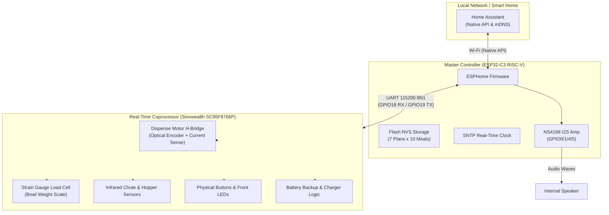

# Pawsync PPF-R361S Smart Pet Feeder — 100% Local ESPHome Firmware

[](https://opensource.org/licenses/MIT)
[](https://esphome.io/)
[](https://www.espressif.com/en/products/socs/esp32-c3)
[](https://github.com/sibero80/pawsync)

Open-source, cloud-free ESPHome firmware and custom C++ external component for the **Pawsync PPF-R361S Smart Pet Feeder** (VeSync model `VS_WB_PFM_PPF-R361S-WUS_US`).

This project completely liberates the feeder from proprietary VeSync cloud services by flashing native ESPHome onto the internal **ESP32-C3 SoC**, delivering **100% local Home Assistant control**, an **autonomous on-device 7-plan hardware scheduler**, **intelligent leftover subtraction**, **live strain gauge bowl weighing**, **automated kibble density calibration**, and **I2S meal call announcements** — while maintaining a **100% zero-soldering software rollback guarantee** to factory firmware.

---

## Table of Contents
- [Architecture Overview](#architecture-overview)
- [Key Features](#key-features)
- [Hardware Specifications & Pinout](#hardware-specifications--pinout)
- [Complete Step-by-Step Replication Guide](#complete-step-by-step-replication-guide)
  - [Prerequisites](#prerequisites)
  - [Method A: 100% Wireless Software OTA Conversion (No Teardown!)](#method-a-100-wireless-software-ota-conversion-no-teardown)
  - [Method B: Wired Serial (UART) Flashing (Hardware Fallback)](#method-b-wired-serial-uart-flashing-hardware-fallback)
  - [First-Boot Setup & Calibration](#first-boot-setup--calibration)
  - [Zero-Risk Factory Firmware Rollback](#zero-risk-factory-firmware-rollback)
- [Deep Reverse-Engineering Breakdown](#deep-reverse-engineering-breakdown)
  - [Dual-Microcontroller Model](#dual-microcontroller-model)
  - [APK Decompilation & ELF Disassembly Insights](#apk-decompilation--elf-disassembly-insights)
  - [UART Protocol Specification](#uart-protocol-specification)
  - [Opcode Dictionary](#opcode-dictionary)
  - [KLV Data Dictionary](#klv-data-dictionary)
  - [Motor Actuation & Gram Target Logic](#motor-actuation--gram-target-logic)
  - [On-Device Hardware RTC Schedule Engine](#on-device-hardware-rtc-schedule-engine)
- [Home Assistant Integration Guide](#home-assistant-integration-guide)
  - [Exposed Entities](#exposed-entities)
  - [Configuring Meals, Times & Portions](#configuring-meals-times--portions)
  - [One-Click Daily Schedule Script](#one-click-daily-schedule-script)
  - [Dashboard Lovelace Card](#dashboard-lovelace-card)
- [Automated Verification & Test Suite](#automated-verification--test-suite)
- [Troubleshooting & FAQ](#troubleshooting--faq)
- [Contributing & Support](#contributing--support)
- [License](#license)

---

## Architecture Overview

The Pawsync PPF-R361S uses a dual-microcontroller architecture designed for fail-safe physical operation:



- **ESP32-C3 Master (ESPHome)**: Handles Wi-Fi networking, Home Assistant API, SNTP time synchronization, audio playback over I2S to the NS4168 amplifier, persistent schedule evaluation, and high-level meal commands.
- **Sinowealth SC95F8766P Coprocessor (Factory Stock)**: Remains on untouched factory firmware. It directly operates the motor H-bridge, monitors optical rotation, measures the strain gauge load cell bridge, and handles battery charging.
- **Zero-Coprocessor-Modification Guarantee**: The coprocessor is never reflashed. Factory motor ramp profiles, current protection, and factory strain gauge calibration constants are preserved 100%.

---

## Key Features

- **100% Local & Cloud-Free**: Zero outbound telemetry to VeSync / AWS servers. Complete privacy and local LAN reliability.
- **Autonomous On-Device Scheduling**: Up to 7 plans × 10 meals per plan saved to ESP32 NVS flash. Continues feeding on time even if Wi-Fi or Home Assistant goes offline.
- **Intelligent Leftover Subtraction**: Automatically tares/weighs residual bowl contents before scheduled meals and dispenses only the delta required to meet the planned target weight.
- **Live Strain Gauge Scale**: Real-time bowl weight in grams with hardware tare zeroing.
- **Automated Kibble Portion Calibration**: Single-click wizard tares the bowl, dispenses test portions, measures the resulting kibble weight, and saves the exact `grams_per_portion` density to NVS and coprocessor EEPROM.
- **I2S Audio Meal Prompts**: Plays local WAV/FLAC audio chime prompts, media announcements, or TTS voice calls when meals are dispensed.
- **Comprehensive Diagnostics**: AC power connection status, battery presence and level, food hopper low infrared sensor, motor jam alarms, and 30-day desiccant countdown.
- **Zero-Soldering Wireless Conversion**: Can be installed entirely over the air from stock firmware using VeSync OTA encapsulation tools.
- **Dual-Boot Rollback Interlock**: Keeps the original stock firmware intact on partition `ota_1`. A protected software switch lets you reboot back into stock factory firmware at any time.

---

## Hardware Specifications & Pinout

### ESP32-C3 SoC Pinout

| Pin | Function | Electrical Connection | Description |
| :--- | :--- | :--- | :--- |
| **`GPIO0`** | Output | `NS4168 CTRL` | Audio amplifier power enable (`HIGH` = Active, `LOW` = Standby/Mute) |
| **`GPIO1`** | Output | `NS4168 LRCLK` | I2S Word Select / Left-Right Clock |
| **`GPIO4`** | Output | `NS4168 BCLK` | I2S Continuous Bit Clock |
| **`GPIO5`** | Output | `NS4168 DOUT` | I2S Serial Audio Data |
| **`GPIO18`** | Input | `UART1 RX` | UART data from Sinowealth SC95F8766P Coprocessor TX |
| **`GPIO19`** | Output | `UART1 TX` | UART data to Sinowealth SC95F8766P Coprocessor RX |

### Flash Partition Layout (`partitions.csv`)

The feeder is equipped with a 4MB (32Mbit) SPI NOR flash:

```text
# ESP-IDF Partition Table
# Name,   Type, SubType, Offset,   Size,     Flags
otadata,  data, ota,     0x00d000, 0x002000,
phy_init, data, phy,     0x00f000, 0x001000,
nvs,      data, nvs,     0x010000, 0x008000,
ota_0,    app,  ota_0,   0x020000, 0x140000,  # 1.25 MB: ESPHome Firmware
ota_1,    app,  ota_1,   0x160000, 0x140000,  # 1.25 MB: Stock Factory Firmware (Protected)
fac_data, data, nvs,     0x2a0000, 0x004000,  # Factory calibration & serial data
custom_data, data, nvs,  0x2a4000, 0x004000,
storage,  data, spiffs,  0x2a8000, 0x158000,
```

---

## Complete Step-by-Step Replication Guide

### Prerequisites
1. Linux, macOS, or Windows WSL2 machine with Python 3.9+ installed.
2. ESPHome 2024.6.0 or newer:
   ```bash
   pip install esphome
   ```
3. Clone this repository:
   ```bash
   git clone https://github.com/sibero80/pawsync.git
   cd pawsync
   ```
4. Copy the secrets template and configure your Wi-Fi:
   ```bash
   cp secrets.yaml.example secrets.yaml
   ```
   Edit `secrets.yaml`:
   ```yaml
   wifi_ssid: "Your_Home_WiFi"
   wifi_password: "Your_WiFi_Password"
   api_encryption_key: "YOUR_GENERATED_BASE64_KEY="
   ```

---

### Method A: 100% Wireless Software OTA Conversion (No Teardown!)

The stock VeSync firmware checks for OTA updates via HTTP and expects an encrypted 129-byte container header followed by the binary. Using our included tools, you can package the ESPHome binary and serve it directly to the stock feeder.

#### Step 1: Compile ESPHome Firmware
Compile the ESPHome binary for the PPF-R361S:
```bash
esphome compile pawsync.yaml
```
The compiled binary will be located at `.esphome/build/pawsync-feeder/build/firmware.ota.bin`.

#### Step 2: Encapsulate into VeSync Container
Package the binary using `tools/ota/build_vesync_ota.py`. This prepends the 129-byte VeSync container header (AES-128-CBC encryption, MD5 checksum, target model `PPF-R361S`):
```bash
python3 tools/ota/build_vesync_ota.py \
  .esphome/build/pawsync-feeder/build/firmware.ota.bin \
  pawsync_ota_update.bin
```

#### Step 3: Trigger the OTA Update
Ensure your computer and the stock feeder are on the same local network.

Run the automated trigger and staging script:
```bash
python3 tools/ota/trigger_ota.py \
  --device-ip <STOCK_FEEDER_IP> \
  --package pawsync_ota_update.bin
```

**How It Works**:
1. The script starts a local HTTP staging server on port 8000.
2. It sends an update directive to the feeder.
3. The feeder requests the update file over HTTP.
4. The server delivers the 129-byte VeSync header, then **paces for 8.0 seconds** while the feeder erases partition `ota_0` (a required safety delay discovered during ELF disassembly).
5. The binary streams to the device, the feeder verifies the MD5 hash, flashes `ota_0`, switches the boot partition, and reboots directly into ESPHome!

---

### Method B: Wired Serial (UART) Flashing (Hardware Fallback)

If the feeder cannot be reached over Wi-Fi, you can flash it via serial:

#### Step 1: Open the Feeder Enclosure
1. Unplug the feeder and remove the food hopper and stainless bowl.
2. Remove the rubber feet on the bottom of the base to expose 4 Phillips screws.
3. Remove the screws and carefully separate the lower base to reveal the main PCB.

#### Step 2: Connect USB-to-UART Adapter
Locate the ESP32-C3 test pads on the PCB:
- **`3V3`** -> Connect to 3.3V on adapter (or power via original DC power supply)
- **`GND`** -> Connect to GND on adapter
- **`TX` (GPIO19)** -> Connect to RX on adapter
- **`RX` (GPIO18)** -> Connect to TX on adapter
- **`BOOT` (GPIO9)** -> Hold to GND while powering on to enter download mode

#### Step 3: Back Up Factory Flash (Mandatory!)
Before flashing, save a full 4MB image of the original stock firmware:
```bash
esptool.py --chip esp32c3 -p /dev/ttyUSB0 -b 921600 read_flash 0x0 0x400000 esp32c3_dump.bin
```

#### Step 4: Flash ESPHome
Flash the compiled firmware directly:
```bash
esphome run pawsync.yaml --device /dev/ttyUSB0
```

---

### First-Boot Setup & Calibration

1. Once booted, the feeder will connect to your Wi-Fi and appear in Home Assistant under **Settings** → **Devices & Services** → **ESPHome**.
2. **Tare the Bowl Scale**: Ensure the bowl is completely empty and seated on the feeder base. In Home Assistant, press:
   - `button.pawsync_ppf_r361s_feeder_tare_bowl_scale`
   - The bowl weight sensor will zero to `0.0g`.
3. **Run Kibble Portion Calibration**:
   - Ensure the bowl is empty.
   - Press `button.pawsync_ppf_r361s_feeder_calibrate_kibble_density_empty_bowl_first`.
   - The feeder will automatically tare, dispense 2 test portions, wait 3.5 seconds for the kibble to settle, weigh the result, and calculate your kibble's exact grams-per-portion density (typically 8.0g–12.0g).
   - This value is permanently saved to flash and synced to the coprocessor.
4. **Test Dispense**: Press `button.pawsync_ppf_r361s_feeder_feed_1_portion` to verify smooth motor rotation and telemetry reporting.

---

### Zero-Risk Factory Firmware Rollback

We have engineered a dual-slot safety mechanism into [`pawsync.yaml`](pawsync.yaml). The original stock firmware remains safely stored in the `ota_1` partition:

To return to the original factory firmware:
1. Go to Home Assistant and turn **ON** the switch:
   `switch.pawsync_ppf_r361s_feeder_unlock_factory_firmware_rollback`
2. Press the button:
   `button.pawsync_ppf_r361s_feeder_rollback_to_factory_firmware_slot_ota_1`
3. The ESP32-C3 will change its bootloader partition table pointer to `ota_1` and reboot cleanly into the factory VeSync firmware.

---

## Deep Reverse-Engineering Breakdown

### Dual-Microcontroller Model

The feeder divides tasks between the master SoC and the coprocessor:
- Communication occurs via 115200 baud UART on `GPIO18` (RX) and `GPIO19` (TX).
- The protocol employs variable-length binary framing with Key-Length-Value (KLV) payloads.
- The coprocessor acts as an autonomous hardware controller that manages real-time motor pulses and load cell sampling.

---

### APK Decompilation & ELF Disassembly Insights

By decompiling the official companion Android APK (`com.vesync.pawsync`) using JADX and disassembling the stock RISC-V binary (`app_active.elf`) extracted from flash address `0x42000000`, we unraveled the following key mechanisms:

| Address | Function in Stock ELF | Discovered Behavior & Parity Fix |
| :--- | :--- | :--- |
| `0x42009d76` | `pet_feeder_uart_set_food_output` | **Motor Dispense Trigger**: Expects Opcode `0x5590`, Frame Type `0x22`, Key 1 = target weight in grams (uint16 LE), Key 2 = cutoff (0x0000), Key 3 = feed type (0). |
| `0x4200a2c2` | `pet_feeder_food_output_situation_handle_klv` | **Dispense Result Telemetry**: Opcode `0x5596`. Key 2 represents `food_output_weight` (grams dispensed), NOT portion count. |
| `0x4200a5d0` | `pet_feeder_report_zero_result_event` | **Tare Result ACK**: Opcode `0x55A3`. Key 1 is status: `0` = OK, `1` = bowlConnAbnormal, `2` = weightFluctuation, `3` = bowlNotPlaced. Key 2 is source flag. |
| `0x4200a6e0` | `pet_feeder_measuring_feed_handle_klv` | **Stock Measuring Calibration**: Opcode `0x5599`. Key 4 = status (`0`), Key 2 = total grams, Key 3 = portion count. |
| `0x42009aca` | `savePetSingleMealMeasure` | **Persist Density to Coprocessor**: Opcode `0x5599`. Key 1 = `0x00`, Key 2 = grams per portion (uint16 LE). |
| `0x42009a00` | `pet_feeder_uart_set_childlock` | **Child Lock Bypass**: Opcode `0x5140`. Disengaging child lock (`0x00`) is required before sending feed commands over UART. |
| `0x42009cf0` | `pet_feeder_uart_set_temperature_correct` | **Schedule Myth Busted**: Opcode `0x55A6` is for factory load-cell thermal calibration, NOT schedule sync. Schedules are evaluated locally on the ESP32. |

---

### UART Protocol Specification

#### Frame Layout

Every UART frame begins with header byte `0xA5`:

```text
[0xA5] [FrameType] [Seq] [Len_L] [Len_H] [Checksum] [Payload: Len Bytes]
  0       1          2      3      4         5             6 ... (Len+5)
```

- **Byte 0**: Sync Header (`0xA5`).
- **Byte 1**: Frame Type:
  - `0x22`: Master Request (requires ACK from coprocessor).
  - `0x21`: Notification / Unsolicited event.
  - `0x12`: ACK frame.
- **Byte 2**: Frame Sequence counter (`0x00`–`0xFF`).
- **Bytes 3–4**: Payload Length in Little-Endian (`uint16_t`).
- **Byte 5**: Checksum byte:
  ```text
  Checksum = (~sum(all frame bytes except index 5)) & 0xFF
  ```
  *(The sum of all frame bytes modulo 256 equals `0xFF`).*

#### Inner Payload Format (Protocol Version 0x02)

```text
[ProtoVer: 0x02] [Opcode_L] [Opcode_H] [Status: 0x00] [KLV Item 1] [KLV Item 2] ...
       0              1          2            3              4+
```

Each KLV item consists of:
```text
[Key ID (1 Byte)] [Length (1 Byte)] [Value (Length Bytes)]
```

---

### Opcode Dictionary

| Opcode | Hex | Source | Description |
| :--- | :---: | :---: | :--- |
| `OPCODE_WIFI_LED` | `0x5018` | ESP32 → MCU | Set front Wi-Fi indicator LED (`0` = Off, `1` = Blinking, `2` = Solid On) |
| `OPCODE_CHILD_LOCK` | `0x5140` | ESP32 → MCU | Enable (`1`) or Disable (`0`) physical front button lock |
| `OPCODE_REBOOT_MCU` | `0x5141` | ESP32 → MCU | Failsafe command to reset the coprocessor MCU and immediately kill motor PWM |
| `OPCODE_FEED_CMD` | `0x5590` | ESP32 → MCU | Dispense meal command with gram target weight |
| `OPCODE_STATUS_POLL` | `0x5592` | ESP32 → MCU | Periodic device status poll query |
| `OPCODE_STATUS_REPORT`| `0x5593` | MCU → ESP32 | Full telemetry status report |
| `OPCODE_DISPENSE_PROGRESS`| `0x5594` | MCU → ESP32 | In-progress dispense status |
| `OPCODE_CLOCK_REQ` | `0x5595` | MCU → ESP32 | Coprocessor requests Unix timestamp synchronization |
| `OPCODE_DISPENSE_RESULT`| `0x5596` | MCU → ESP32 | Dispense completed: reports grams dispensed and status code |
| `OPCODE_BUTTON_EVENT` | `0x5597` | MCU → ESP32 | Physical front button press notification |
| `OPCODE_PLAY_AUDIO` | `0x5598` | MCU → ESP32 | Request to play meal call audio chime |
| `OPCODE_MEASURING` | `0x5599` | Bi-dir | Coprocessor kibble density measurement and EEPROM density sync |
| `OPCODE_SLOW_FEED` | `0x55A0` | ESP32 → MCU | Enable/disable slow feed staged dispensing |
| `OPCODE_SLEEP_MODE` | `0x55A0` | ESP32 → MCU | Night sleep mode (silence LEDs and chimes) |
| `OPCODE_CLOCK_SYNC` | `0x55A1` | ESP32 → MCU | Push Unix epoch timestamp to coprocessor |
| `OPCODE_TARE_BOWL` | `0x55A3` | Bi-dir | Zero the bowl strain gauge load cell |

---

### KLV Data Dictionary

#### Status Report (`0x5593`) & Status Poll Response (`0x5592`)

| Key | Len | Type | Description |
| :---: | :---: | :---: | :--- |
| `3` | 1 | `uint8` | Child lock state (`0` = Unlocked, `1` = Locked) |
| `4` | 1 | `uint8` | Food hopper infrared level (`0` = Sufficient, `1` = Food Low) |
| `5` | 1 | `uint8` | Backup battery percentage (`0` = Not Installed, `1`–`100` = Percentage) |
| `6` | 1 | `uint8` | Power source mode (`0` = AC Wall Power, `1` = Battery Backup Mode) |
| `7` | 1 | `uint8` | Motor error code (`0` = Normal, `1` = Motor Jammed, `2` = Chute Blocked) |
| `11` | 2 | `int16_LE` | Live bowl food weight in grams (0–500 g) |

#### Dispense Result (`0x5596`)

| Key | Len | Type | Description |
| :---: | :---: | :---: | :--- |
| `2` | 2 | `uint16_LE` | Actual food weight dispensed in grams (`food_output_weight`) |
| `3` | 1 | `uint8` | Dispense completion code (`0` = Success, `1` = Jam, `2` = Chute error) |

#### Bowl Tare (`0x55A3`)

| Key | Len | Type | Description |
| :---: | :---: | :---: | :--- |
| `1` | 1 | `uint8` | Status code (`0` = Success, `1` = Connection error, `2` = Unstable weight, `3` = Bowl missing) |
| `2` | 1 | `uint8` | Trigger source (`1` = Remote software command, `0` = Hardware button) |

---

### Motor Actuation & Gram Target Logic

A critical finding from decompiling `app_active.elf`: **The feeder coprocessor does not dispense by portion count; it dispenses by target weight in grams.**

When you command `P` portions:
```text
Target Grams = round(P * grams_per_portion)
```

If `child_lock` is active, the coprocessor rejects motor commands over UART. The ESPHome component automatically disengages the child lock for the duration of the dispense and restores it when feeding completes.

---

### On-Device Hardware RTC Schedule Engine

To ensure feeding never fails during Wi-Fi or Home Assistant downtime, schedules are stored in the ESP32's non-volatile flash (NVS) using ESPHome `ESPPreferenceObject`:

```cpp
struct ScheduleStorage {
  uint32_t magic{0x50534348}; // 'PSCH'
  uint8_t active_plan_idx{0};  // 0..6 (Plans 1 to 7)
  bool intelligent_feeding{false};
  float grams_per_portion{8.0f};
  uint32_t last_desiccant_reset_epoch{0};
  FeedingPlan plans[7];        // 7 distinct plans, 10 meals each
};
```

Every minute, the internal SNTP RTC compares the current day and minute against active meals. 

#### Intelligent Leftover Subtraction Math
When `intelligent_feeding` is enabled:
```text
Target Meal Weight = Planned Portions * grams_per_portion
```
- If `Residual Bowl Weight >= Target Meal Weight`: **Dispense 0 portions** (bowl already has sufficient food).
- If `Residual Bowl Weight < Target Meal Weight`:
  ```text
  Portions to Dispense = ceil((Target Meal Weight - Residual Bowl Weight) / grams_per_portion)
  ```

---

## Home Assistant Integration Guide

### Exposed Entities

| Entity ID | Domain | Description |
| :--- | :---: | :--- |
| `sensor.pawsync_ppf_r361s_feeder_bowl_weight` | Sensor | Real-time pet bowl food weight in grams (0–500 g) |
| `sensor.pawsync_ppf_r361s_feeder_last_feed_weight` | Sensor | Weight of food dispensed in the most recent meal |
| `sensor.pawsync_ppf_r361s_feeder_portions_today` | Sensor | Cumulative portions dispensed today (resets at midnight) |
| `sensor.pawsync_ppf_r361s_feeder_battery_level` | Sensor | Battery level percentage (reports `unavailable` if uninstalled) |
| `sensor.pawsync_ppf_r361s_feeder_desiccant_days_remaining` | Sensor | 30-day countdown to silica desiccant replacement |
| `binary_sensor.pawsync_ppf_r361s_feeder_ac_power_connected` | Binary Sensor | `ON` when plugged into AC wall adapter, `OFF` on battery |
| `binary_sensor.pawsync_ppf_r361s_feeder_food_level_low` | Binary Sensor | `ON` when food hopper is nearly empty |
| `binary_sensor.pawsync_ppf_r361s_feeder_motor_jammed` | Binary Sensor | `ON` if food jam or motor overcurrent is detected |
| `binary_sensor.pawsync_ppf_r361s_feeder_bowl_scale_connected` | Binary Sensor | `ON` when stainless bowl is seated on the load cell |
| `binary_sensor.pawsync_ppf_r361s_feeder_battery_installed` | Binary Sensor | `ON` when physical backup batteries are present |
| `text_sensor.pawsync_ppf_r361s_feeder_feeder_status` | Text Sensor | Operational status (`Online / Standby`, `Dispensing...`, etc.) |
| `text_sensor.pawsync_ppf_r361s_feeder_next_scheduled_meal` | Text Sensor | Countdown to next meal today (`18:00 (3 portions)`) |
| `text_sensor.pawsync_ppf_r361s_feeder_today_s_schedule_summary`| Text Sensor | Formatted summary of all active meals for today |
| `switch.pawsync_ppf_r361s_feeder_intelligent_feeding_leftover_deduction` | Switch | Enables automatic leftover bowl weight deduction |
| `switch.pawsync_ppf_r361s_feeder_child_lock` | Switch | Locks front physical buttons to prevent pet tampering |
| `switch.pawsync_ppf_r361s_feeder_slow_feed_mode` | Switch | Dispenses food in paced intervals to prevent rapid eating |
| `switch.pawsync_ppf_r361s_feeder_sleep_mode` | Switch | Night sleep mode: silences LEDs and audio chimes |
| `button.pawsync_ppf_r361s_feeder_feed_1_portion` | Button | Dispenses 1 portion immediately |
| `button.pawsync_ppf_r361s_feeder_tare_bowl_scale` | Button | Zeroes the bowl scale load cell |
| `button.pawsync_ppf_r361s_feeder_calibrate_kibble_density_empty_bowl_first` | Button | Automated calibration wizard (taring + 2 portions) |
| `button.pawsync_ppf_r361s_feeder_reset_desiccant_30_days` | Button | Resets desiccant timer back to 30 days |
| `select.pawsync_ppf_r361s_feeder_active_feeding_plan` | Select | Switch between Plan 1 through Plan 7 |
| `number.pawsync_ppf_r361s_feeder_grams_per_portion_kibble_calibration` | Number | Dynamic kibble density setting in grams |
| `media_player.pawsync_ppf_r361s_feeder_meal_call_speaker` | Media Player | Plays custom audio files, chimes, or TTS meal calls |

---

### Configuring Meals, Times & Portions

ESPHome exposes two native API actions to Home Assistant:

#### Action: `esphome.pawsync_feeder_set_meal_schedule`

```yaml
action: esphome.pawsync_feeder_set_meal_schedule
data:
  plan: 1         # Plan 1 to 7 (or 0 for active plan)
  meal: 1         # Meal slot 1 to 10
  enabled: true
  hour: 7         # 07:00 AM (24-hour format)
  minute: 30
  portions: 2     # Number of portions (~11.5g each = ~23g)
  days: 127       # 127 = Every day
  sound: true     # Play audio chime
```

**Days Bitmask**:
- Sunday = 1, Monday = 2, Tuesday = 4, Wednesday = 8, Thursday = 16, Friday = 32, Saturday = 64
- **`127`**: Everyday (`0x7F`)
- **`62`**: Weekdays Mon–Fri (`0x3E`)
- **`65`**: Weekends Sat–Sun (`0x41`)

#### Action: `esphome.pawsync_feeder_clear_plan`

```yaml
action: esphome.pawsync_feeder_clear_plan
data:
  plan: 1
```

---

### One-Click Daily Schedule Script

Add this script to Home Assistant (`scripts.yaml`) to set up a complete daily feeding schedule with one click:

```yaml
sequence:
  - action: esphome.pawsync_feeder_clear_plan
    data:
      plan: 1

  # Meal 1: Breakfast at 07:30 AM (2 portions ~ 23g)
  - action: esphome.pawsync_feeder_set_meal_schedule
    data:
      plan: 1
      meal: 1
      enabled: true
      hour: 7
      minute: 30
      portions: 2
      days: 127
      sound: true

  # Meal 2: Lunch at 12:30 PM (1 portion ~ 11.5g)
  - action: esphome.pawsync_feeder_set_meal_schedule
    data:
      plan: 1
      meal: 2
      enabled: true
      hour: 12
      minute: 30
      portions: 1
      days: 127
      sound: true

  # Meal 3: Dinner at 18:30 PM (3 portions ~ 34.5g)
  - action: esphome.pawsync_feeder_set_meal_schedule
    data:
      plan: 1
      meal: 3
      enabled: true
      hour: 18
      minute: 30
      portions: 3
      days: 127
      sound: true
mode: single
alias: "Setup PawSync Plan 1 (Breakfast, Lunch, Dinner)"
icon: mdi:food-drumstick
```

---

### Dashboard Lovelace Card

A clean Mushroom Card layout for your Home Assistant dashboard:

```yaml
type: vertical-stack
cards:
  - type: custom:mushroom-title-card
    title: Pawsync Smart Feeder
    subtitle: 100% Local ESPHome Control
  - type: horizontal-stack
    cards:
      - type: custom:mushroom-entity-card
        entity: sensor.pawsync_ppf_r361s_feeder_bowl_weight
        name: Bowl Weight
        icon: mdi:scale
      - type: custom:mushroom-entity-card
        entity: sensor.pawsync_ppf_r361s_feeder_portions_today
        name: Portions Today
        icon: mdi:counter
  - type: custom:mushroom-template-card
    primary: "Next Meal: {{ states('sensor.pawsync_ppf_r361s_feeder_next_scheduled_meal') }}"
    secondary: "{{ states('sensor.pawsync_ppf_r361s_feeder_today_s_schedule_summary') }}"
    icon: mdi:calendar-clock
  - type: horizontal-stack
    cards:
      - type: custom:mushroom-button-card
        entity: button.pawsync_ppf_r361s_feeder_feed_1_portion
        name: Feed 1 Portion
        icon: mdi:food-drumstick
      - type: custom:mushroom-button-card
        entity: button.pawsync_ppf_r361s_feeder_tare_bowl_scale
        name: Tare Scale
        icon: mdi:scale-balance
```

---

## Automated Verification & Test Suite

This repository includes automated tests to ensure firmware safety, container integrity, and stock parity.

### Run OTA Packaging & Safety Guardrail Tests
```bash
python3 tests/test_ota_pipeline.py
```
**Validates**:
1. AES-128-CBC encryption and MD5 integrity verification.
2. Partition capacity enforcement (blocks oversized binaries > 1.25MB).
3. ESP32 image magic byte validation (`0xE9`).
4. VeSync cloud bypass envelope schemas and WAF sanitization.
5. Local HTTP server streaming and flash erase pacing.

### Run End-to-End Home Assistant Parity Tests
```bash
export HA_URL="http://YOUR_HA_IP:8123"
export HA_TOKEN="YOUR_LONG_LIVED_ACCESS_TOKEN"
python3 tests/test_feeder_parity.py
```
**Validates**:
1. Online status and telemetry heartbeat.
2. Scale tare actuation and zeroing confirmation.
3. Desiccant lifetime tracker and reset button.
4. Battery presence detection.
5. Motor dispense execution and strain gauge weight delta verification.

---

## Troubleshooting & FAQ

### Q: Tare fails with "Tare Failed: Unstable Weight"
- **Cause**: The feeder is on an uneven, soft, or vibrating surface, or pet activity is bumping the bowl.
- **Fix**: Place the feeder on a solid, flat surface. Ensure the stainless bowl is empty and resting squarely on the load cell sensor pads before pressing Tare.

### Q: Calibration reports "Calibration Failed: Hopper empty?"
- **Cause**: The test dispense produced less than 2.0 grams of food.
- **Fix**: Refill the food hopper with kibble, verify the motor chute is unblocked, and run the calibration button again.

### Q: Why does the battery level show "unavailable"?
- **Behavior**: The feeder is running on AC wall adapter power and no backup batteries are inserted. This matches factory stock behavior (Opcode `0x5593` Key 5 = `0`). Once backup batteries are installed, the battery level percentage and `binary_sensor.battery_installed` turn `ON`.

### Q: Feeder buttons do not respond when pressed physically
- **Behavior**: Child Lock is enabled. Turn off `switch.pawsync_ppf_r361s_feeder_child_lock` in Home Assistant to unlock the physical buttons.

---

## Contributing & Support

Contributions, issue reports, and pull requests are welcomed!
- **GitHub Repository**: [https://github.com/sibero80/pawsync](https://github.com/sibero80/pawsync)
- **Bug Reports**: Open an issue detailing your feeder model, firmware version, and log output.

---

## License

This project is licensed under the [MIT License](LICENSE).

---
*Disclaimer: Pawsync and VeSync are trademarks of their respective owners. This open-source project is an independent clean-room reverse-engineering effort and is not affiliated with or endorsed by VeSync.*
