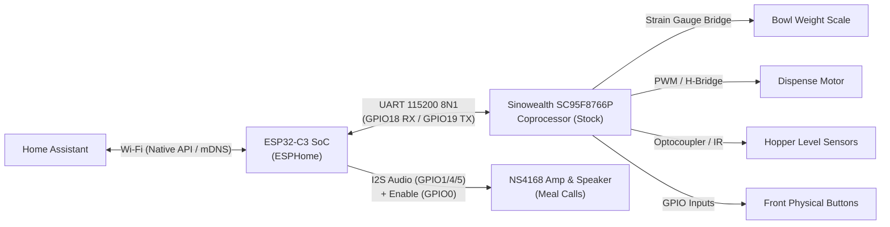

# Pawsync PPF-R361S Smart Pet Feeder — 100% Local ESPHome Firmware

Open-source, cloud-free ESPHome firmware and custom external component for the **Pawsync PPF-R361S Smart Pet Feeder** (VeSync model `VS_WB_PFM_PPF-R361S-WUS_US`).

This project completely replaces the proprietary cloud firmware on the feeder's internal ESP32-C3 microcontroller with native ESPHome, enabling full local control through Home Assistant with zero dependency on the VeSync cloud.

---

## Architecture Overview

The feeder utilizes a dual-microcontroller architecture:



- **ESP32-C3 (Wi-Fi / Audio Host)**: Runs ESPHome. It speaks the native VeSync binary framing protocol to the coprocessor, manages time synchronization, and plays meal call audio over the internal I2S amplifier.
- **Sinowealth SC95F8766P (Real-Time Coprocessor)**: Remains untouched on factory firmware. It drives the motor, measures the bowl strain gauge, and handles battery charging logic.
- **Zero-Coprocessor-Modification Guarantee**: The coprocessor firmware is never reflashed, preserving factory motor protection curves and scale calibration coefficients.

---

## Exposed Home Assistant Entities

### Sensors & Diagnostics
- **Bowl Weight** (`sensor.pawsync_feeder_bowl_weight`): Real-time pet bowl food weight in grams ($0\text{–}500\text{ g}$).
- **Battery Level** (`sensor.pawsync_feeder_battery_level`): Backup battery percentage ($0\text{–}100\%$).
- **Last Feed Weight** (`sensor.pawsync_feeder_last_feed_weight`): Measured weight dispensed in the most recent meal.
- **Portions Today** (`sensor.pawsync_feeder_portions_today`): Daily portion counter tracking dispensed food.

### Binary Sensors
- **AC Power Connected** (`binary_sensor.pawsync_feeder_ac_power_connected`): `ON` when plugged into DC wall power, `OFF` when running on battery.
- **Food Level Low** (`binary_sensor.pawsync_feeder_food_level_low`): `ON` when food hopper is nearly empty.
- **Motor Jammed** (`binary_sensor.pawsync_feeder_motor_jammed`): `ON` if food jam or motor overcurrent is detected.
- **Bowl Scale Connected** (`binary_sensor.pawsync_feeder_bowl_scale_connected`): `ON` when the stainless bowl is seated on the load cell.

### Controls & Actions
- **Feed 1 Portion Button** (`button.pawsync_feeder_feed_1_portion`): Immediately triggers dispensing of 1 portion.
- **Tare Bowl Scale Button** (`button.pawsync_feeder_tare_bowl_scale`): Zeroes the bowl scale load cell.
- **Manual Feed Portions** (`number.pawsync_feeder_manual_feed_portions`): Portion selector ($1\text{–}20$ portions).
- **Active Feeding Plan** (`select.pawsync_feeder_active_feeding_plan`): Switch between up to 7 independent on-device plan profiles ("Daily Plan", "Weekday Plan", "Weekend Plan", etc.).
- **Next Scheduled Meal** (`text_sensor.pawsync_feeder_next_scheduled_meal`): Real-time countdown/time of the next upcoming meal today.
- **Schedule Summary** (`text_sensor.pawsync_feeder_today_s_schedule_summary`): Visual overview of all active meals for today.
- **Intelligent Feeding Switch** (`switch.pawsync_feeder_intelligent_feeding_leftover_deduction`): Enables automatic bowl leftover deduction so pets are never overfed.
- **Child Lock Switch** (`switch.pawsync_feeder_child_lock`): Locks/unlocks physical buttons on the feeder.
- **Slow Feed Mode Switch** (`switch.pawsync_feeder_slow_feed_mode`): Enables staged interval dispensing to prevent pets from eating too quickly.
- **Sleep Mode Switch** (`switch.pawsync_feeder_sleep_mode`): Disables front status LEDs and chimes at night.
- **Meal Call Speaker** (`media_player.pawsync_feeder_meal_call_speaker`): Play custom chimes, TTS voice prompts, or local WAV/FLAC audio files when meals are served.

---

## Hardware Pinout (ESP32-C3)

| Pin | Direction | Function | Connection |
| :--- | :--- | :--- | :--- |
| **`GPIO0`** | Output | Audio Amp Power Enable | High = Active, Low = Standby / Mute (`NS4168 CTRL`) |
| **`GPIO1`** | Output | I2S Word Select / LRCLK | `NS4168 L/R Clock` |
| **`GPIO4`** | Output | I2S Bit Clock (BCLK) | `NS4168 BCLK` |
| **`GPIO5`** | Output | I2S Data Out (DOUT) | `NS4168 Audio Data In` |
| **`GPIO18`** | Input | UART1 RX | Data from SC95F8766P Coprocessor TX |
| **`GPIO19`** | Output | UART1 TX | Data to SC95F8766P Coprocessor RX |

---

## Getting Started

### 1. Requirements
- ESPHome 2024.6.0 or newer.
- 3.3V USB-to-UART serial converter for initial flashing.
- Solderless pogo-pins or test leads.

### 2. Flashing
Follow the step-by-step instructions in the [Flashing & Rollback Guide](docs/flashing_guide.md):
1. **Back up factory flash**: Extract the full 4MB factory image (`esp32c3_dump.bin`).
2. **Configure secrets**: Edit `secrets.yaml` with your Wi-Fi credentials.
3. **Compile & flash**:
   ```bash
   esphome run pawsync.yaml
   ```

---

## Technical Documentation

### Core Architectural Specifications & Comparison
- [`docs/01_hardware_and_discovered_features.md`](docs/01_hardware_and_discovered_features.md): Master hardware specification, pinout, partition map, and discovered features.
- [`docs/02_apk_feature_flow_and_protocol.md`](docs/02_apk_feature_flow_and_protocol.md): Companion app feature flows, cloud bypass schema, and UART packet structures.
- [`docs/03_stock_to_esphome_parity_matrix.md`](docs/03_stock_to_esphome_parity_matrix.md): 100% stock-to-ESPHome parity matrix and dual-layer schedule design.
- [`docs/04_home_assistant_integration_design.md`](docs/04_home_assistant_integration_design.md): Home Assistant entity definitions, Mushroom cards, and automation blueprints.
- [`docs/05_software_ota_replication_and_hardening.md`](docs/05_software_ota_replication_and_hardening.md): 100% wireless OTA installation runbook, gap analysis, and zero-soldering software rollback.
- [`docs/06_openwrt_and_hotspot_deployment_guide.md`](docs/06_openwrt_and_hotspot_deployment_guide.md): OpenWrt router network operations, tcpdump tracking, /www/ staging, and mobile hotspot runbook.
- [`docs/peer_review_ota_analysis_and_remediation_guide.md`](docs/peer_review_ota_analysis_and_remediation_guide.md): Exhaustive peer review dossier, gap remediation, and complete drop-in reference tooling for partner agents.
- [`docs/findings_comparison.md`](docs/findings_comparison.md): Exhaustive comparison between prior preliminary findings and verified ground truth.
- [`docs/validation_dossier.md`](docs/validation_dossier.md): Comprehensive validation sitemap, tool inventory, and verification runbooks.
- [`docs/flashing_guide.md`](docs/flashing_guide.md): Solderless serial flashing and 100% rollback guarantee runbook.

### Detailed Reverse-Engineering Findings (`docs/findings/`)
- [`01_flash_layout.md`](docs/findings/01_flash_layout.md): Flash partition map, NVS namespaces, and extracted meal audio.
- [`02_firmware_identity.md`](docs/findings/02_firmware_identity.md): Firmware version (v1.2.5), build timestamps, and SDK analysis.
- [`03_gpio_map.md`](docs/findings/03_gpio_map.md): Proven GPIO and peripheral assignments.
- [`04_uart_protocol.md`](docs/findings/04_uart_protocol.md): Frame format, header byte (`0xA5`), checksum algorithm, and packet dispatching.
- [`05_opcode_dictionary.md`](docs/findings/05_opcode_dictionary.md): Comprehensive opcode and KLV data item dictionary.
- [`06_audio.md`](docs/findings/06_audio.md): NS4168 audio amplifier integration and I2S configuration.
- [`07_power_battery_schedule.md`](docs/findings/07_power_battery_schedule.md): Battery power lifecycle and autonomous offline schedule handling.
- [`tools/proto/vesync_proto.py`](tools/proto/vesync_proto.py): Standalone reference Python protocol encoder/decoder with unit tests.
- [`tools/ota/build_vesync_ota.py`](tools/ota/build_vesync_ota.py): Hardened VeSync OTA package generator with strict 1.25 MB partition size enforcement.
- [`tools/ota/trigger_ota.py`](tools/ota/trigger_ota.py): Dual-vector staging & trigger runner (Port 55555 probe + Cloud Bypass injection + local HTTP staging).
- [`tests/test_ota_pipeline.py`](tests/test_ota_pipeline.py): Automated test suite for OTA packaging, crypto roundtrips, and HTTP transfer.

---

## License

This project is licensed under the MIT License.
