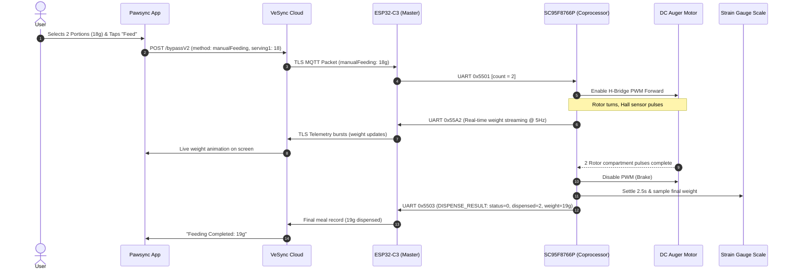

# Pawsync Companion App: Feature Flows, Cloud Transport & Protocol Interaction

> **Target Application:** Pawsync Pet App (`com.pawsync.pet`)  
> **Target Version:** `v1.1.32` (Build Code `46`, Compile SDK 35 / Android 15)  
> **Source Evidence:** Bytecode decompilation (`classes*.dex` via JADX), network schema reverse-engineering, and live OpenWrt packet inspection (`feeder_feed_event.pcap`).

---

## 1. Mobile Application Architecture

The Pawsync pet feeder is managed primarily through the Android companion application `com.pawsync.pet`. Unlike older smart-home appliances that dynamically download web-based H5 or React Native bundles from cloud CDNs, the Pawsync app is built with a **100% native Android UI stack**:

- **UI Framework:** Android Jetpack Compose alongside classic Material Design components.
- **Networking Stack:** Square Retrofit 2 + OkHttp 3 with reactive RxJava 2 and Kotlin Coroutines.
- **Architecture Pattern:** MVVM (Model-View-ViewModel) with persistent SQLite/Room caching.
- **Device Control Panel:** Hardcoded natively in `com.pawsync.pet.device.ui.device.feeder.*`. All UI layouts, validation rules, error strings, and payload builders are present in the application binary without external dependencies.

---

## 2. Cloud Transport, Protocol Tunneling & Wire Encryption

### 2.1 The VeSync Cloud Bypass Pipeline

All interactions between the mobile app and the feeder route through the VeSync centralized cloud infrastructure via a dedicated "bypass" protocol. The bypass endpoint tunnels device-specific JSON payloads across an enterprise MQTT/TLS broker to the physical feeder:

```
+------------------+         HTTPS POST /bypassV2         +-----------------------+
|  Pawsync App     | -----------------------------------> |   VeSync Cloud Core   |
| (Android/iOS)    | <----------------------------------- | (smartapi.vesync.com) |
+------------------+         JSON Bypass Envelope         +-----------+-----------+
                                                                      |
                                                               TLS 1.2 Encrypted
                                                               Port 3883 (AWS IoT)
                                                                      |
                                                                      v
                                                          +-----------+-----------+
                                                          |  ESP32-C3 Wi-Fi SoC   |
                                                          |    (Stock Firmware)   |
                                                          +-----------+-----------+
                                                                      |
                                                               UART0 (115200 8N1)
                                                               Binary KLV Frames
                                                                      |
                                                                      v
                                                          +-----------+-----------+
                                                          |  SC95F8766P Coproc    |
                                                          | (Motor, Scale, Opto)  |
                                                          +-----------------------+
```

### 2.2 Cloud Bypass Envelope Specification

Every device transaction wraps an inner payload inside the standardized VeSync bypass envelope:

#### Request Envelope (`POST /pet/api/deviceManaged/v1/bypassV2`):
```json
{
  "context": {
    "traceId": "1730000000000",
    "accountID": "12345678",
    "token": "us_token_hex_sequence",
    "userType": "1",
    "bizType": "pet",
    "countryCode": "US",
    "language": "en",
    "timeZone": "America/New_York",
    "appVersion": "1.1.32"
  },
  "data": {
    "method": "manualFeeding",
    "source": "APP",
    "data": {
      "cid": "feeder-uuid-identifier",
      "configModule": "VS_WB_PFM_PPF-R361S-WUS_US",
      "serving1": 18,
      "serving2": null
    }
  }
}
```

#### Response Envelope:
```json
{
  "code": 0,
  "msg": "ok",
  "result": {
    "code": 0,
    "feedStatus": "feeding"
  }
}
```

### 2.3 Live Traffic Verification & Impossibility of Local Cloud Hijacking

Live network capture on an OpenWrt gateway (`feeder_feed_event.pcap`) revealed:
1. **Remote Cloud Broker:** `34.225.33.72:3883` (`ec2-34-225-33-72.compute-1.amazonaws.com` in AWS us-east-1).
2. **Strict TLS 1.2 Enforcement:** All traffic uses TLS application data records (`0x17 0x03 0x03`).
3. **Hardcoded Root CA Certificate Validation:** The ESP32-C3 stock binary embeds the Amazon Root CA certificate. Attempting to spoof the cloud broker using DNS redirection or DNAT transparent proxying fails during the TLS handshake (`SSL_ALERT_BAD_CERTIFICATE`).
4. **Conclusion:** Flashing the ESP32-C3 with a native local firmware (ESPHome) is the **only viable architectural method** to achieve 100% cloud independence without hacking cloud certificates or maintaining fragile cloud tunnels.

---

## 3. Comprehensive APK Feature Dictionary & Firmware Mapping

Below is the complete dictionary of all discovered app methods, their UI triggers, JSON parameters, and how they map down to the stock firmware and coprocessor UART opcodes:

### 3.1 Device Status & Capability Discovery

| Cloud Bypass Method | UI Trigger in Mobile App | JSON Request Payload | JSON Response Fields | Translated UART Opcode |
|---|---|---|---|---|
| **`getPetDeviceStatus`** | Polled every 5–10s on Feeder Home screen, pull-to-refresh, app foreground resume. | `{"cid": "...", "configModule": "..."}` | `bowlWeight` (g), `singleWeight_g` (g), `portion` (count), `lastFeedWeight` (g), `contentInPot` (0–100%), `contentRemainTime` (days), `powerAdapter` (0/1), `energy` (0–100%), `bowlConnected` (normal/abnormal), `zeroStatus` (0/1/2), `slowFeedMode`, `intelligentFeeding`, `accurateFeeding`, `sleepMode`, `setVoice`. | `0x55A1` (Weight)<br>`0x5522` (Food Level)<br>`0x5541` (Power/Battery)<br>`0x5521` (Lid) |
| **`getPetFunction`** | Initial device pairing, profile refresh. | `{"cid": "...", "configModule": "..."}` | Returns device capabilities: `maxPlanCount` (7), `maxMealCountPerPlan` (10), `maxPortionPerMeal` (20), `potVolume_ml` (4000), `supportVoice` (1), `supportCorrection` (1). | *Handled entirely in ESP32 firmware* |

### 3.2 Dispense Operations

| Cloud Bypass Method | UI Trigger in Mobile App | JSON Request Payload | JSON Response Fields | Translated UART Opcode |
|---|---|---|---|---|
| **`manualFeeding`** | User taps "Feed" button $\to$ selects portion count (1–20) on wheel dialog. | `{"cid": "...", "serving1": 18, "serving2": null}` *(Note: `serving1` transmits target grams: `portions * singleWeight_g`)* | `{"code": 0, "feedStatus": "feeding"}` | `0x5501` (`[count: u8]`) followed by continuous `0x55A2` streaming |
| **`stopFeeding`** | User taps "Stop" while feeding is actively in progress. | `{"cid": "..."}` | `{"code": 0}` | `0x5502` (Motor stop) |
| **`clearJam`** | User taps "Clear Food Jam" alert banner. | `{"cid": "..."}` | `{"code": 0}` | `0x5504` (Anti-jam motor reverse sequence) |

### 3.3 Meal Planning & On-Device Schedule Management

| Cloud Bypass Method | UI Trigger in Mobile App | JSON Request Payload | JSON Response Fields | Storage & Execution Location |
|---|---|---|---|---|
| **`getFeedingPlanList`** | Navigation to "Feeding Plan" tab. | `{"cid": "...", "index": 0}` | `{"total": 1, "planList": [{"planId": 101, "planName": "Daily", "enable": 1, "repeat": 254, "dailyTotalWeightG": 90}]}` | Read from ESP32 NVS partition (`plan_param`) |
| **`getFeedingPlanDetail`**| User taps an individual plan to view meal timings. | `{"cid": "...", "planId": 101}` | `{"planId": 101, "planName": "...", "repeat": 254, "scheduleList": [{"timeSec": 28800, "weight": 30}, ...]}` | Read from ESP32 NVS partition (`plan_param`) |
| **`createFeedingPlan`** | User creates a new plan profile (up to 7 profiles). | `{"planName": "...", "repeat": 124, "scheduleList": [...]}` | `{"planId": 102}` | Written to ESP32 NVS partition (`plan_param`) |
| **`updateFeedingPlan`** | User modifies meal times or gram portions in existing plan. | `{"planId": 101, "scheduleList": [...]}` | `{"code": 0}` | Overwrites plan entry in ESP32 NVS partition (`plan_param`) |
| **`setFeedingPlanStatus`**| User toggles master plan enable switch. | `{"planId": 101, "enable": 0\|1}` | `{"code": 0}` | Updates plan status flag in ESP32 NVS |

### 3.4 Calibration & Maintenance

| Cloud Bypass Method | UI Trigger in Mobile App | JSON Request Payload | JSON Response Fields | Translated UART Opcode |
|---|---|---|---|---|
| **`tareScale`** | User navigates to Settings $\to$ "Zero Food Bowl" (with bowl empty). | `{"cid": "..."}` | `{"zeroStatus": 0}` | `0x55A3` (Tare Scale command to coprocessor) |
| **`calibrateSingleWeight`**| User launches "Food Portion Calibration" wizard (dispenses 3 test portions). | `{"cid": "...", "measuredWeight_g": 29}` | `{"singleWeight_g": 9.6}` | `0x55A3` $\to$ `0x5501` (3 portions) $\to$ `0x55A1` |
| **`resetDesiccant`** | User replaces desiccant pack in lid and taps "Reset Timer". | `{"cid": "..."}` | `{"desiccantRemainTime": 30}` | Stored in NVS / App state (resets 30-day countdown) |

### 3.5 Device Configuration & Safety Interlocks

| Cloud Bypass Method | UI Trigger in Mobile App | JSON Request Payload | Function & Behavior |
|---|---|---|---|
| **`setIntelligentFeeding`**| Toggle switch in Settings. | `{"enable": 0\|1}` | When enabled, feeder reads leftover kibble in bowl prior to dispensing and deducts leftovers to prevent bowl overflow. |
| **`setSlowFeedMode`** | Toggle switch in Settings. | `{"enable": 0\|1}` | Feeder pauses 10–15 seconds between individual portions during multi-portion meals to prevent fast eating/vomiting. |
| **`setAccurateFeeding`** | Toggle switch in Settings. | `{"enable": 0\|1}` | Enables micro-step motor trimming based on weight feedback. |
| **`setChildLock`** | Toggle switch in Settings. | `{"enable": 0\|1}` | Transmits `0x5511` to coprocessor to lock out the front physical button. |
| **`setVoice`** | Toggle switch in Settings. | `{"enable": 0\|1}` | Controls whether meal chime is played during dispensing (`0x5531`). |
| **`setSleepMode`** | DND Night Schedule picker. | `{"enable": 1, "startClkSec": 79200, "endClkSec": 25200}` | Turns off front LED and mutes chime during bedtime hours. |

---

## 4. End-to-End Operational Workflows

### 4.1 Workflow 1: Manual Dispense Execution



### 4.2 Workflow 2: On-Device Schedule Storage & Offline Autonomy

One of the most critical reverse-engineering discoveries is that **schedules do NOT rely on cloud timers or active Wi-Fi connections**:
1. When the user saves a feeding plan in the mobile app, the cloud delivers the full schedule array (`scheduleList`) to the ESP32-C3.
2. The ESP32-C3 writes this array directly into its onboard SPI flash NVS partition (`plan_param`).
3. An internal FreeRTOS timer checks the local real-time clock (RTC) every minute.
4. When RTC matches a meal entry (`timeSec`) and the weekly bitmask matches today's day of week, the ESP32 initiates the feed cycle locally over UART without sending any outbound internet requests.
5. If the feeder loses Wi-Fi, internet access, or cloud connection, **it continues to feed on schedule indefinitely**.

### 4.3 Workflow 3: Automated Kibble Portion Calibration Wizard

Kibble size and geometry vary significantly:

```
     Kitten Kibble: ~7-9g/portion      Medium Dog: ~10-12g/portion      Large Dog: ~14-18g/portion
```

To guarantee that a "40g meal" actually dispenses 40 grams, the app provides a guided calibration wizard:
1. **Empty Bowl Prompt:** App instructs user: *"Please remove all food from the stainless steel bowl and replace it on the base."*
2. **Tare Execution:** App sends `tareScale`. The coprocessor takes 64 ADC samples of the empty bowl and resets the strain gauge zero point (`0x55A3`).
3. **3-Portion Test Dispense:** Feeder automatically dispenses exactly 3 portions of kibble into the bowl (`0x5501` count=3).
4. **Settling & Weighing:** Motor stops. Feeder waits 3.0 seconds for kibble movement to settle. The 24-bit ADC reads total weight $W_{\text{total}}$.
5. **Density Calculation:** The system calculates:
   $$\text{singleWeight\_g} = \frac{W_{\text{total}}}{3.0}$$
6. **Persistence:** The calculated `singleWeight_g` is saved into flash NVS. All future schedules specified in grams use this ratio to calculate portion counts:
   $$\text{Portions to Dispense} = \operatorname{round}\left(\frac{\text{Target Grams}}{\text{singleWeight\_g}}\right)$$

### 4.4 Workflow 4: Pet Eating Behavior Detection & Meal Consumption Journal

The Pawsync app tracks not only what was dispensed, but **how much the pet actually consumed**:
1. After a dispense event, the bowl contains weight $W_0$.
2. When the pet approaches and eats, the load-cell sensor detects continuous downward force followed by weight reduction.
3. When the weight stabilizes at $W_1 < W_0$ for more than 60 seconds (determined by `mealMeasureTimeout: 60` from `getPetFunction`), an "Eating Event" is recorded:
   $$\text{Kibble Eaten} = W_0 - W_1$$
4. The event logs timestamp, meal duration, and grams eaten into the cloud feeding history graph.
