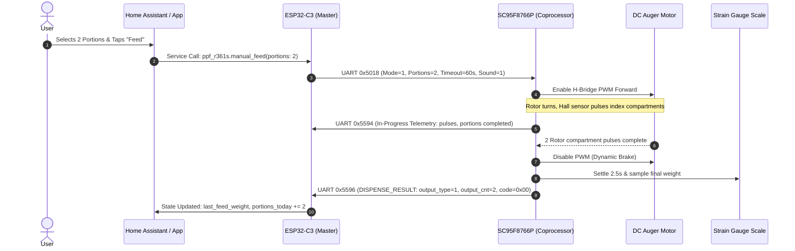

# Pawsync Companion App: Feature Flows, Cloud Transport & Protocol Interaction

> **Target Application:** Pawsync Pet App (`com.pawsync.pet`)  
> **Target Version:** `v1.1.32` (Build Code `46`, Compile SDK 35 / Android 15)  
> **Source Evidence:** Bytecode decompilation (`classes*.dex` via JADX), network schema reverse-engineering ([`09_apk_api_schema.json`](file:///root/pawsync_oma2/docs/findings/09_apk_api_schema.json)), and live OpenWrt packet inspection (`feeder_feed_event.pcap`).

---

## 1. Mobile Application Architecture

The Pawsync pet feeder is managed primarily through the Android companion application `com.pawsync.pet`. Unlike older smart-home appliances that dynamically download web-based H5 or React Native bundles from cloud CDNs, the Pawsync app is built with a **100% native Android UI stack**:

- **UI Framework:** Android Jetpack Compose alongside classic Material Design components.
- **Networking Stack:** Square Retrofit 2 + OkHttp 3 with reactive RxJava 2 and Kotlin Coroutines.
- **Architecture Pattern:** MVVM (Model-View-ViewModel) with persistent SQLite/Room caching.
- **Device Control Panel:** Hardcoded natively in `com.pawsync.pet.device.ui.device.feeder.*`. All UI layouts, validation rules, error strings, and payload builders are present in the application binary without external dependencies.

---

## 2. Cloud Transport, Protocol Tunneling & Wire Encryption

### 2.1 The VeSync Cloud Bypass Pipeline

All interactions between the mobile app and the feeder route through the VeSync centralized cloud infrastructure via a dedicated "bypass" protocol. The bypass endpoint tunnels device-specific JSON payloads across an enterprise MQTT/TLS broker to the physical feeder:

```
+------------------+         HTTPS POST /bypassV2         +-----------------------+
|  Pawsync App     | -----------------------------------> |   VeSync Cloud Core   |
| (Android/iOS)    | <----------------------------------- | (smartapi.vesync.com) |
+------------------+         JSON Bypass Envelope         +-----------+-----------+
                                                                      |
                                                               TLS 1.2 Encrypted
                                                               Port 3883 (AWS IoT)
                                                                      |
                                                                      v
                                                          +-----------+-----------+
                                                          |  ESP32-C3 Wi-Fi SoC   |
                                                          |    (Stock Firmware)   |
                                                          +-----------+-----------+
                                                                      |
                                                               UART0 (115200 8N1)
                                                               Binary KLV Frames
                                                                      |
                                                                      v
                                                          +-----------+-----------+
                                                          |  SC95F8766P Coproc    |
                                                          | (Motor, Scale, Opto)  |
                                                          +-----------------------+
```

### 2.2 Cloud Bypass Envelope Specification

Every device transaction wraps an inner payload inside the standardized VeSync bypass envelope:

#### Request Envelope (`POST /pet/api/deviceManaged/v1/bypassV2`):
```json
{
  "context": {
    "traceId": "1730000000000",
    "accountID": "12345678",
    "token": "us_token_hex_sequence",
    "userType": "1",
    "bizType": "pet",
    "countryCode": "US",
    "language": "en",
    "timeZone": "America/New_York",
    "appVersion": "1.1.32"
  },
  "data": {
    "method": "manualFeeding",
    "source": "APP",
    "data": {
      "cid": "feeder-uuid-identifier",
      "configModule": "VS_WB_PFM_PPF-R361S-WUS_US",
      "serving1": 18,
      "serving2": null
    }
  }
}
```

#### Response Envelope:
```json
{
  "code": 0,
  "msg": "ok",
  "result": {
    "code": 0,
    "feedStatus": "feeding"
  }
}
```

### 2.3 Live Traffic Verification & Impossibility of Local Cloud Hijacking

Live network capture on an OpenWrt gateway (`feeder_feed_event.pcap`) revealed:
1. **Remote Cloud Broker:** `34.225.33.72:3883` (`ec2-34-225-33-72.compute-1.amazonaws.com` in AWS us-east-1).
2. **Strict TLS 1.2 Enforcement:** All traffic uses TLS application data records (`0x17 0x03 0x03`).
3. **Hardcoded Root CA Certificate Validation:** The ESP32-C3 stock binary embeds the Amazon Root CA certificate. Attempting to spoof the cloud broker using DNS redirection or DNAT transparent proxying fails during the TLS handshake (`SSL_ALERT_BAD_CERTIFICATE`).
4. **Conclusion:** Flashing the ESP32-C3 with a native local firmware (ESPHome) is the **only viable architectural method** to achieve 100% cloud independence without hacking cloud certificates or maintaining fragile cloud tunnels.

---

## 3. Comprehensive APK Feature Dictionary & Firmware Mapping

Below is the complete dictionary of all discovered app methods, their UI triggers, JSON parameters, and how they map down to the confirmed stock firmware and coprocessor UART opcodes:

### 3.1 Device Status & Capability Discovery

| Cloud Bypass Method | UI Trigger in Mobile App | JSON Request Payload | JSON Response Fields | Translated UART Opcode & Payload |
|---|---|---|---|---|
| **`getPetDeviceStatus`** | Polled every 5–10s on Feeder Home screen, pull-to-refresh, app foreground resume. | `{"cid": "...", "configModule": "..."}` | `bowlWeight` (g), `singleWeight_g` (g), `portion` (count), `lastFeedWeight` (g), `contentInPot` (0–100%), `contentRemainTime` (days), `powerAdapter` (0/1), `energy` (0–100%), `bowlConnected` (normal/abnormal), `zeroStatus` (0/1/2), `slowFeedMode`, `intelligentFeeding`, `accurateFeeding`, `sleepMode`, `setVoice`. | **`0x5590`** (Poll trigger) $\to$ Coprocessor returns **`0x5593`**:<br>• Key 3: `child_lock`<br>• Key 4: `food_remind` (Hopper low)<br>• Key 5: `battery_percent`<br>• Key 7: `powerAdapter` (0=Battery, 1=AC)<br>• Key 8: `bowlWeight` (Signed g) |
| **`getPetFunction`** | Initial device pairing, profile refresh. | `{"cid": "...", "configModule": "..."}` | Returns device capabilities: `maxPlanCount` (7), `maxMealCountPerPlan` (10), `maxPortionPerMeal` (20), `potVolume_ml` (4000), `supportVoice` (1), `supportCorrection` (1). | *Handled entirely in ESP32 firmware* |

### 3.2 Dispense Operations

| Cloud Bypass Method | UI Trigger in Mobile App | JSON Request Payload | JSON Response Fields | Translated UART Opcode & Payload |
|---|---|---|---|---|
| **`manualFeeding`** | User taps "Feed" button $\to$ selects portion count (1–20) on wheel dialog. | `{"cid": "...", "serving1": 18, "serving2": null}` *(Note: `serving1` transmits target grams: `portions * singleWeight_g`)* | `{"code": 0, "feedStatus": "feeding"}` | **`0x5018`** (`MANUAL_FEED`):<br>• Key 1: Mode (`1` = portion count)<br>• Key 2: Portions (`1`..`20`)<br>• Key 3: Timeout (`0`..`60`s)<br>• Key 4: Sound flag (`0`=silent, `1`=chime)<br>Coprocessor reports **`0x5594`** in-progress and **`0x5596`** result. |
| **`stopFeeding`** | User taps "Stop" while feeding is actively in progress. | `{"cid": "..."}` | `{"code": 0}` | Feed times out or terminates at current pocket cycle; coprocessor returns final **`0x5596`**. |
| **`clearJam`** | User taps "Clear Food Jam" alert banner. | `{"cid": "..."}` | `{"code": 0}` | Coprocessor executes auto anti-jam 3× reverse routine. Error cleared upon successful feed or tare. |

### 3.3 Meal Planning & On-Device Schedule Management

| Cloud Bypass Method | UI Trigger in Mobile App | JSON Request Payload | JSON Response Fields | Storage & Execution Location |
|---|---|---|---|---|
| **`getFeedingPlanList`** | Navigation to "Feeding Plan" tab. | `{"cid": "...", "index": 0}` | `{"total": 1, "planList": [{"planId": 101, "planName": "Daily", "enable": 1, "repeat": 254, "dailyTotalWeightG": 90}]}` | Read from ESP32 NVS (`usercfg` / `plan_param`) |
| **`getFeedingPlanDetail`**| User taps an individual plan to view meal timings. | `{"cid": "...", "planId": 101}` | `{"planId": 101, "planName": "...", "repeat": 254, "scheduleList": [{"timeSec": 28800, "weight": 30}, ...]}` | Read from ESP32 NVS (`usercfg` / `plan_param`) |
| **`createFeedingPlan`** | User creates a new plan profile (up to 7 profiles). | `{"planName": "...", "repeat": 124, "scheduleList": [...]}` | `{"planId": 102}` | Written to ESP32 NVS; pushed to coprocessor via **`0x55A6`** (`PLAN_SYNC`). |
| **`updateFeedingPlan`** | User modifies meal times or gram portions in existing plan. | `{"planId": 101, "scheduleList": [...]}` | `{"code": 0}` | Overwrites plan entry in ESP32 NVS; pushed to coprocessor via **`0x55A6`**. |
| **`setFeedingPlanStatus`**| User toggles master plan enable switch. | `{"planId": 101, "enable": 0\|1}` | `{"code": 0}` | Updates plan status flag in ESP32 NVS; synchronized to coprocessor via **`0x55A6`**. |

### 3.4 Calibration & Maintenance

| Cloud Bypass Method | UI Trigger in Mobile App | JSON Request Payload | JSON Response Fields | Translated UART Opcode & Payload |
|---|---|---|---|---|
| **`tareScale`** | User navigates to Settings $\to$ "Zero Food Bowl" (with bowl empty). | `{"cid": "..."}` | `{"zeroStatus": 0}` | **`0x55A3`** (Tare Scale command, empty payload). Coprocessor responds with **`0x55A3`** Key 1 `s_zero_result`: `0x00` = OK, `0x01` = Unstable, `0x02` = Bowl Absent. |
| **`calibrateSingleWeight`**| User launches "Food Portion Calibration" wizard (dispenses 3 test portions). | `{"cid": "...", "measuredWeight_g": 29}` | `{"singleWeight_g": 9.6}` | Sequence: **`0x55A3`** (Tare) $\to$ **`0x5018`** (3 portions) $\to$ settle 3s $\to$ read **`0x5593`** Key 8 (`bowlWeight`). Divide by 3 to store `singleWeight_g`. |
| **`resetDesiccant`** | User replaces desiccant pack in lid and taps "Reset Timer". | `{"cid": "..."}` | `{"desiccantRemainTime": 30}` | Stored in NVS / ESPPreferences (resets 30-day countdown). |

### 3.5 Device Configuration & Safety Interlocks

| Cloud Bypass Method | UI Trigger in Mobile App | JSON Request Payload | Translated UART Opcode & Function |
|---|---|---|---|
| **`setIntelligentFeeding`**| Toggle switch in Settings. | `{"enable": 0\|1}` | **`0x5592`** Key 1: Leftover deduction switch (`0`=Off, `1`=On). When enabled, feeder reads bowl weight prior to feed and deducts leftovers to prevent overflow. |
| **`setSlowFeedMode`** | Toggle switch in Settings. | `{"enable": 0\|1}` | **`0x5107`** Key 1: Slow feed switch (`0`=Off, `1`=On). Feeder pauses 10–15 seconds between individual portions during multi-portion meals. |
| **`setChildLock`** | Toggle switch in Settings. | `{"enable": 0\|1}` | **`0x5104`** Key 1: Lock state (`0`=Unlocked, `1`=Locked). Disables front physical button `K2` on coprocessor to prevent pet tampering. |
| **`setVoice`** | Toggle switch in Settings. | `{"enable": 0\|1}` | Controls audio meal chime playback on ESP32 NS4168 amplifier via GPIO0 `AMP_EN` and buzzer switch **`0x5141`**. |
| **`setSleepMode`** | DND Night Schedule picker. | `{"enable": 1, "startClkSec": 79200, "endClkSec": 25200}` | **`0x5105`** Key 1: Sleep mode (`0`=Normal, `1`=Sleep). Turns off front LEDs (`0x5140` mode 0) and mutes buzzer chime during bedtime hours. |

---

## 4. End-to-End Operational Workflows

### 4.1 Workflow 1: Manual Dispense Execution



### 4.2 Workflow 2: Dual-Layer Schedule Architecture & Offline Battery Autonomy

A cornerstone of this feeder's design is **unconditional battery offline autonomy**:
1. When a feeding plan is configured or enabled via Home Assistant or the mobile app, the full schedule is saved to the ESP32 flash (`ESPPreferences`).
2. The ESP32 immediately pushes the active plan table down to the Sinowealth SC95F8766P coprocessor using opcode **`0x55A6`** (`PLAN_SYNC`).
3. The ESP32 synchronizes its SNTP real-time clock down to the coprocessor using opcode **`0x55A1`** (`CLOCK_SYNC`).
4. **Autonomous Battery Execution**:
   - If AC power is disconnected (`0x5593` Key 7 = 0), the ESP32 can turn off Wi-Fi or enter low-power light sleep to preserve the 3× D-cell batteries.
   - The Sinowealth SC95F8766P coprocessor ($<50\ \mu\text{A}$ sleep) continues running its internal hardware RTC and evaluates the stored `0x55A6` schedule table independently.
   - At the scheduled meal time, the coprocessor autonomously activates the motor H-bridge, indexes the required portions, and records the dispense result in its EEPROM.
   - Physical buttons (`K2` Manual Feed, `K4` Unlock) continue to function offline on coprocessor hardware interrupts.
5. **Chime Synchronization**:
   - When running on AC power, the coprocessor emits opcode **`0x5598`** (`SCHEDULE_TRIGGER`) at the start of a scheduled meal.
   - The ESP32 receives `0x5598`, asserts GPIO0 `AMP_EN` (HIGH), and plays `meal_call.wav` through the NS4168 Class-D amplifier so pets hear the owner's voice prompt.
6. **AC Reconnection & History Replay**:
   - When AC power is restored, the ESP32 wakes Wi-Fi, queries status via `0x5590`, refreshes the clock with `0x55A1`, and reconciles any offline feeding counts with Home Assistant.

### 4.3 Workflow 3: Automated Kibble Portion Calibration Wizard

Kibble size and geometry vary significantly across brands and formulas:

```
     Kitten Kibble: ~7-9g/portion      Medium Dog: ~10-12g/portion      Large Dog: ~14-18g/portion
```

To guarantee that a gram-based meal plan dispenses accurate weight, the feeder uses a 3-portion calibration sequence:
1. **Empty Bowl Prompt:** User removes all kibble from the stainless steel bowl and seats it on the base scale dock.
2. **Tare Execution:** ESP32 issues opcode **`0x55A3`** (Tare). The coprocessor takes 64 ADC samples of the empty bowl and resets the load-cell zero baseline, returning `s_zero_result = 0x00`.
3. **3-Portion Test Dispense:** Feeder automatically dispenses exactly 3 portions using opcode **`0x5018`** (`portions = 3`).
4. **Settling & Weighing:** Motor stops. The system pauses 3.0 seconds for kibble vibrations to damp out. The 24-bit ADC reads total weight $W_{\text{total}}$ reported in **`0x5593`** Key 8 (`bowlWeight`).
5. **Density Calculation:** The system calculates:
   $$\text{singleWeight\_g} = \frac{W_{\text{total}}}{3.0}$$
6. **Persistence:** The calculated `singleWeight_g` is saved into flash (`ESPPreferences`). All subsequent schedules specified in grams use this ratio to compute portion counts:
   $$\text{Portions to Dispense} = \operatorname{round}\left(\frac{\text{Target Grams}}{\text{singleWeight\_g}}\right)$$

### 4.4 Workflow 4: Pet Eating Behavior Detection & Meal Consumption Journal

The load cell detects not only what was dispensed, but **how much and when the pet ate**:
1. After dispensing, the bowl contains weight $W_0$.
2. When the pet eats, the load cell registers continuous force fluctuations followed by stable weight reduction.
3. When the weight stabilizes at $W_1 < W_0$ for more than 60 seconds (matching `mealMeasureTimeout: 60`), an "Eating Event" is recorded:
   $$\text{Kibble Eaten} = W_0 - W_1$$
4. Home Assistant logs the timestamp, eating duration, and consumed grams into long-term statistics for pet nutrition tracking.
