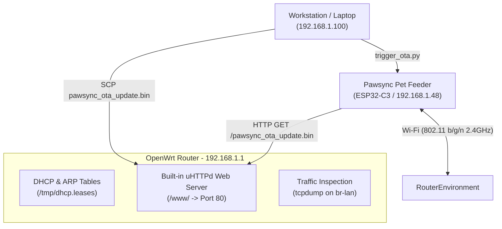

# OpenWrt & Mobile Hotspot Wireless Deployment Guide for Pawsync PPF-R361S

> **Target Device:** Pawsync Smart Pet Feeder (`PPF-R361S` / `PPF-R361S-WUS`)  
> **Vendor Model ID:** `VS_WB_PFM_PPF-R361S-WUS_US` (BLE ID: `92`)  
> **Target SoC:** ESP32-C3FH4 (4MB Flash, RISC-V 160MHz) + Sinowealth SC95F8766P Coprocessor  
> **Author:** Antigravity Engineering Lead  
> **Date:** October 2026  
> **Workspace:** [`/root/pawsync_oma2`](file:///root/pawsync_oma2)  

---

## 1. Network Topology & Deployment Overview

The user environment features an **OpenWrt-based home router** (`192.168.1.1`) acting as the primary LAN gateway, DHCP server, and Wi-Fi access point, with an optional **mobile phone hotspot** available for direct, isolated connectivity.



### Key Advantages of Router-Native Staging:
1. **Guaranteed Local MTU & Low Latency:** Serving the 1.14 MB firmware directly from the OpenWrt router avoids Wi-Fi-to-Wi-Fi relay bottlenecks.
2. **Deterministic Packet Visibility:** Running `tcpdump` directly on the OpenWrt router's bridge interface (`br-lan`) provides real-time byte-level insight into the download progress.
3. **No Firewall Traversal Issues:** The router's `/www/` directory is natively accessible to all devices on the LAN over port 80.

---

## 2. Phase 1: Identifying the Feeder on OpenWrt

Connect to your OpenWrt router via SSH:
```bash
ssh root@192.168.1.1
```

### 2.1 Inspect DHCP Leases
Search the active DHCP lease table for the ESP32-C3 device:
```bash
cat /tmp/dhcp.leases | grep -E "espressif|pawsync|VS_"
```
*Example Output:*
```text
1730005421 dc:54:75:e8:14:2c 192.168.1.48 espressif *
```
*(Espressif MAC OUI prefix is typically `dc:54:75`, `84:f7:03`, `30:ae:a4`, or `24:dc:c3`).*

### 2.2 Inspect ARP Table & Ping Feeder
Verify that the device responds to ICMP echo requests on the LAN bridge:
```bash
grep "192.168.1.48" /proc/net/arp
ping -c 3 192.168.1.48
```

---

## 3. Phase 2: Staging Firmware Directly in OpenWrt `/www/`

Because OpenWrt runs an internal web server (`uhttpd`) serving files from `/www/` on port 80, placing the OTA package in `/www/` eliminates the need to run an external Python HTTP server.

### 3.1 Copy Package to OpenWrt from Workstation
From your development workstation in `/root/pawsync_oma2`:
```bash
scp pawsync_ota_update.bin root@192.168.1.1:/www/pawsync_ota_update.bin
```

### 3.2 Verify Staging on Router
On the OpenWrt router:
```bash
ls -lh /www/pawsync_ota_update.bin
md5sum /www/pawsync_ota_update.bin
```
The file is now accessible across the entire LAN at:
`http://192.168.1.1/pawsync_ota_update.bin`

---

## 4. Phase 3: Real-Time Traffic Inspection on OpenWrt

On the OpenWrt router, monitor the feeder's network activity in real time using `tcpdump`:

```bash
tcpdump -i br-lan host 192.168.1.48 -nn
```

To specifically monitor the HTTP firmware download handshake and chunk transfer:
```bash
tcpdump -i br-lan host 192.168.1.48 and port 80 -nn -vv
```

---

## 5. Phase 4: Dispatching the Wireless Update Trigger

From your workstation in `/root/pawsync_oma2`:

### Path A: Local Developer Port (If Port 55555 is Open)
1. **Probe the port:**
   ```bash
   /root/esphome/venv/bin/python3 tools/ota/trigger_ota.py --probe --feeder-ip 192.168.1.48
   ```
2. **If Port 55555 is OPEN, inject local JSON:**
   ```bash
   /root/esphome/venv/bin/python3 tools/ota/trigger_ota.py --inject-local \
     --feeder-ip 192.168.1.48 \
     --url http://192.168.1.1/pawsync_ota_update.bin
   ```

### Path B: VeSync Cloud Bypass V2 Ingress (Factory Stock Feeder Fallback)
If port 55555 is closed (default out-of-the-box state), send the trigger via VeSync Cloud Bypass V2:
```bash
/root/esphome/venv/bin/python3 tools/ota/trigger_ota.py --inject-cloud \
  --account-id "<YOUR_VESYNC_ACCOUNT_ID>" \
  --token "<YOUR_VESYNC_TOKEN>" \
  --cid "<YOUR_DEVICE_CID>" \
  --url http://192.168.1.1/pawsync_ota_update.bin
```

---

## 6. Phase 5: Monitoring the Flashing Process

Watch your OpenWrt `tcpdump` terminal:
1. **HTTP GET Request:** You will see the feeder initiate a TCP handshake to `192.168.1.1:80` and issue:
   `GET /pawsync_ota_update.bin HTTP/1.1`
2. **Streaming Transfer:** Packets will stream rapidly across `br-lan` (~10–15 seconds for 1.14 MB).
3. **Download Complete & Reboot:** The TCP connection terminates cleanly (`FIN/ACK`). The feeder's ESP32-C3 writes `otadata`, validates the header MD5, and reboots.
4. **DHCP Re-Lease:** Within 5–10 seconds, the device will request a new DHCP lease as `pawsync-feeder`.
5. **Home Assistant Discovery:** The device announces mDNS (`pawsync-feeder.local`) on port 6053, and Home Assistant automatically prompts to configure the Pawsync Pet Feeder integration.

---

## 7. Alternative: Mobile Phone Hotspot Deployment Runbook

If you prefer to isolate the device on your smartphone's mobile hotspot:

### 7.1 Setup Hotspot
1. Configure your phone's personal hotspot:
   - **SSID:** `Pawsync-Setup` (or your existing home Wi-Fi SSID)
   - **Password:** Must match Wi-Fi credentials in `secrets.yaml`
   - **Band:** 2.4 GHz (Mandatory: ESP32-C3 does not support 5 GHz).
2. Connect both your laptop/workstation and the pet feeder to the mobile hotspot.

### 7.2 Identify IPs
- On Android/iOS: Check connected devices in Personal Hotspot settings to find the feeder's IP (e.g. `172.20.10.4`) and laptop IP (e.g. `172.20.10.2`).

### 7.3 Stage & Trigger via Laptop
1. Launch local HTTP staging server on laptop:
   ```bash
   /root/esphome/venv/bin/python3 tools/ota/trigger_ota.py --serve --http-port 8000
   ```
2. In a second terminal, trigger the update:
   ```bash
   /root/esphome/venv/bin/python3 tools/ota/trigger_ota.py --inject-local \
     --feeder-ip 172.20.10.4 \
     --url http://172.20.10.2:8000/pawsync_ota_update.bin
   ```

---

## 8. Safety & Rollback Verification

Once flashed, verify in Home Assistant:
- **`switch.pawsync_feeder_unlock_factory_rollback`**: Defaults to `OFF`.
- **`button.pawsync_feeder_rollback_to_factory_firmware_slot_ota_1`**: If clicked while the switch is OFF, logs a warning and takes no action.
- To rollback to stock factory firmware wirelessly, toggle the switch `ON`, then press the rollback button. The feeder will reactivate `ota_1` (`0x150000`) and reboot into factory stock firmware in 2 seconds.
