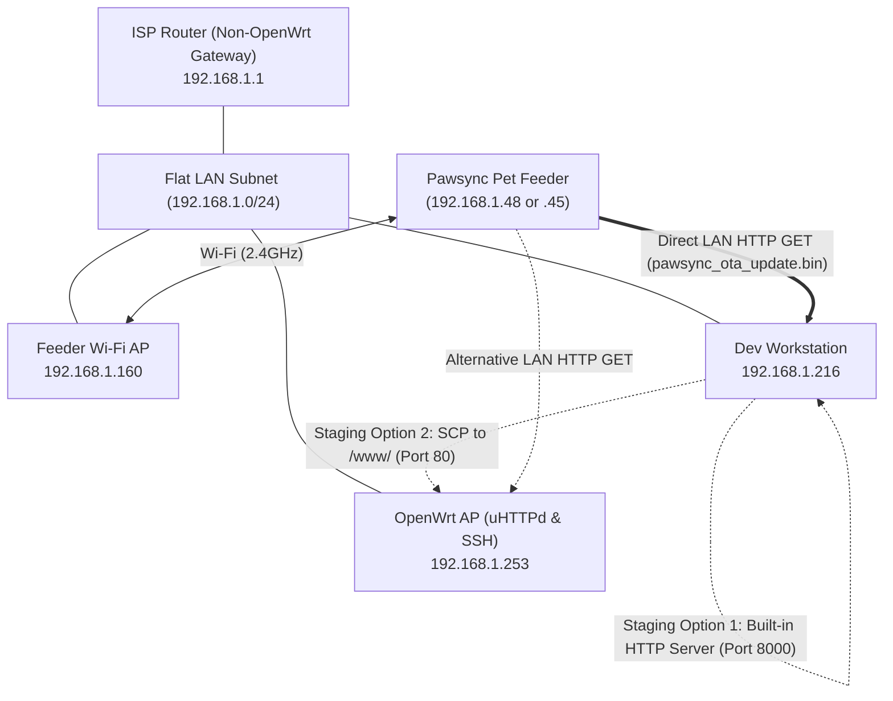

# OpenWrt & Mobile Hotspot Wireless Deployment Guide for Pawsync PPF-R361S

> **Target Device:** Pawsync Smart Pet Feeder (`PPF-R361S` / `PPF-R361S-WUS`)  
> **Vendor Model ID:** `VS_WB_PFM_PPF-R361S-WUS_US` (BLE ID: `92`)  
> **Target SoC:** ESP32-C3FH4 (4MB Flash, RISC-V 160MHz) + Sinowealth SC95F8766P Coprocessor  
> **Author:** Antigravity Engineering Lead  
> **Date:** October 2026  
> **Workspace:** [`/root/pawsync_oma2`](file:///root/pawsync_oma2)  

---

## 1. Network Topology & Deployment Overview

The user environment features a flat `/24` home network subnet (`192.168.1.0/24`) with the following active nodes:
- **ISP Router / Default Gateway (`192.168.1.1`):** Non-OpenWrt ISP gateway handling WAN NAT and primary DHCP.
- **Feeder Access Point (`192.168.1.160`):** The primary Wi-Fi AP currently serving the Pawsync Pet Feeder.
- **OpenWrt AP / Secondary Staging Node (`192.168.1.253`):** OpenWrt access point running SSH (port 22) and uHTTPd (port 80).
- **Development Workstation (`192.168.1.216`):** Host running the ESPHome toolchain, Python OTA server, and bypass scripts.
- **Pawsync Pet Feeder Candidate IPs:** `192.168.1.48` (`94:a9:90:4c:7e:d8`) or `192.168.1.45` (`94:a9:90:4c:18:d8`) (both Espressif MAC OUIs).



### Key Architectural Realizations:
1. **Flat Subnet Simplicity:** All nodes share the `192.168.1.0/24` subnet. The pet feeder can initiate a direct TCP/HTTP connection to the dev workstation (`192.168.1.216:8000`) or OpenWrt (`192.168.1.253:80`) with **zero** routing, NAT, or ISP router interference.
2. **Two Flexible Firmware Staging Options:**
   - **Option A (Workstation-Direct):** Run `tools/ota/trigger_ota.py --serve --http-port 8000` on `192.168.1.216`. Shows live byte transfers directly in your local terminal.
   - **Option B (OpenWrt `/www/`):** Copy the binary to `192.168.1.253:/www/` via `scp`. Staged at `http://192.168.1.253/pawsync_ota_update.bin`.
3. **Ingress Vector Selection:** Because port 55555 returns `ECONNREFUSED` on the stock feeder, the trigger command must be dispatched via **VeSync Cloud Bypass V2** (`--inject-cloud`), which sends the download command over AWS IoT MQTT to the feeder.

---

## 2. Phase 1: Identifying the Feeder IP & MAC Address

Two Espressif devices are present on your LAN:
- `192.168.1.48` (`94:a9:90:4c:7e:d8`)
- `192.168.1.45` (`94:a9:90:4c:18:d8`)

To confirm which device is the Pawsync Pet Feeder:
1. Open the **VeSync App** on your phone.
2. Select your **Pet Feeder** -> Tap **Settings** (gear icon) -> Tap **Device Info**.
3. Note the **MAC Address** (ends in either `7E:D8` or `18:D8`), the **CID (Client ID)**, and your **Account ID**.

---

## 3. Phase 2: Choosing Firmware Staging Location

You have two fast staging options on your flat `192.168.1.0/24` LAN:

### Option A: Workstation Direct HTTP Server (Recommended - Quickest)
Run the built-in HTTP server directly from your workstation (`192.168.1.216`):
```bash
/root/esphome/venv/bin/python3 tools/ota/trigger_ota.py --serve --http-port 8000
```
- Staging URL: `http://192.168.1.216:8000/pawsync_ota_update.bin`
- Advantage: Shows live download progress and byte transfers directly in your active terminal.

### Option B: OpenWrt AP uHTTPd Web Server (`192.168.1.253`)
Copy the binary into the OpenWrt AP's `/www/` directory:
```bash
scp pawsync_ota_update.bin root@192.168.1.253:/www/pawsync_ota_update.bin
```
Verify on OpenWrt (`ssh root@192.168.1.253`):
```bash
ls -lh /www/pawsync_ota_update.bin
```
- Staging URL: `http://192.168.1.253/pawsync_ota_update.bin`

---

## 4. Phase 3: Real-Time Traffic Inspection (Optional)

If using the OpenWrt AP (`192.168.1.253`), you can SSH into OpenWrt and monitor the transfer in real time:

```bash
ssh root@192.168.1.253
tcpdump -i br-lan host <FEEDER_IP> and port 80 -nn -vv
```

---

## 5. Phase 4: Dispatching the Wireless Update Trigger

From your workstation in `/root/pawsync_oma2`:

### Path A: Local Developer Port (If Port 55555 is Open)
1. **Probe the port:**
   ```bash
   /root/esphome/venv/bin/python3 tools/ota/trigger_ota.py --probe --feeder-ip <FEEDER_IP>
   ```
2. **If Port 55555 is OPEN, inject local JSON:**
   ```bash
   /root/esphome/venv/bin/python3 tools/ota/trigger_ota.py --inject-local \
     --feeder-ip <FEEDER_IP> \
     --url http://192.168.1.216:8000/pawsync_ota_update.bin
   ```

### Path B: VeSync Cloud Bypass V2 Ingress (Factory Stock Feeder Ingress)
Because stock feeders leave port 55555 closed (`ECONNREFUSED`), dispatch the command via VeSync Cloud Bypass V2:
```bash
/root/esphome/venv/bin/python3 tools/ota/trigger_ota.py --inject-cloud \
  --account-id "<YOUR_VESYNC_ACCOUNT_ID>" \
  --token "<YOUR_VESYNC_TOKEN>" \
  --cid "<YOUR_DEVICE_CID>" \
  --url http://192.168.1.216:8000/pawsync_ota_update.bin
```
*(Replace URL with `http://192.168.1.253/pawsync_ota_update.bin` if using Option B).*

---

## 6. Phase 5: Monitoring the Flashing Process

Watch your terminal (either the `--serve` output or OpenWrt `tcpdump`):
1. **HTTP GET Request:** The feeder initiates a TCP connection to the staging URL and issues:
   `GET /pawsync_ota_update.bin HTTP/1.1`
2. **Streaming Transfer:** Packets stream across the LAN (~10–15 seconds for 1.14 MB).
3. **Download Complete & Reboot:** The TCP connection terminates cleanly (`FIN/ACK`). The feeder's ESP32-C3 writes `otadata`, validates the header MD5, and reboots.
4. **DHCP Re-Lease:** Within 5–10 seconds, the device will connect to your Wi-Fi AP (`192.168.1.160`) as `pawsync-feeder`.
5. **Home Assistant Discovery:** The device announces mDNS (`pawsync-feeder.local`) on port 6053, and Home Assistant automatically prompts to configure the Pawsync Pet Feeder integration.
   `GET /pawsync_ota_update.bin HTTP/1.1`
2. **Streaming Transfer:** Packets will stream rapidly across `br-lan` (~10–15 seconds for 1.14 MB).
3. **Download Complete & Reboot:** The TCP connection terminates cleanly (`FIN/ACK`). The feeder's ESP32-C3 writes `otadata`, validates the header MD5, and reboots.
4. **DHCP Re-Lease:** Within 5–10 seconds, the device will request a new DHCP lease as `pawsync-feeder`.
5. **Home Assistant Discovery:** The device announces mDNS (`pawsync-feeder.local`) on port 6053, and Home Assistant automatically prompts to configure the Pawsync Pet Feeder integration.

---

## 7. Alternative: Mobile Phone Hotspot Deployment Runbook

If you prefer to isolate the device on your smartphone's mobile hotspot:

### 7.1 Setup Hotspot
1. Configure your phone's personal hotspot:
   - **SSID:** `Pawsync-Setup` (or your existing home Wi-Fi SSID)
   - **Password:** Must match Wi-Fi credentials in `secrets.yaml`
   - **Band:** 2.4 GHz (Mandatory: ESP32-C3 does not support 5 GHz).
2. Connect both your laptop/workstation and the pet feeder to the mobile hotspot.

### 7.2 Identify IPs
- On Android/iOS: Check connected devices in Personal Hotspot settings to find the feeder's IP (e.g. `172.20.10.4`) and laptop IP (e.g. `172.20.10.2`).

### 7.3 Stage & Trigger via Laptop
1. Launch local HTTP staging server on laptop:
   ```bash
   /root/esphome/venv/bin/python3 tools/ota/trigger_ota.py --serve --http-port 8000
   ```
2. In a second terminal, trigger the update:
   ```bash
   /root/esphome/venv/bin/python3 tools/ota/trigger_ota.py --inject-local \
     --feeder-ip 172.20.10.4 \
     --url http://172.20.10.2:8000/pawsync_ota_update.bin
   ```

---

## 8. Safety & Rollback Verification

Once flashed, verify in Home Assistant:
- **`switch.pawsync_feeder_unlock_factory_rollback`**: Defaults to `OFF`.
- **`button.pawsync_feeder_rollback_to_factory_firmware_slot_ota_1`**: If clicked while the switch is OFF, logs a warning and takes no action.
- To rollback to stock factory firmware wirelessly, toggle the switch `ON`, then press the rollback button. The feeder will reactivate `ota_1` (`0x150000`) and reboot into factory stock firmware in 2 seconds.
