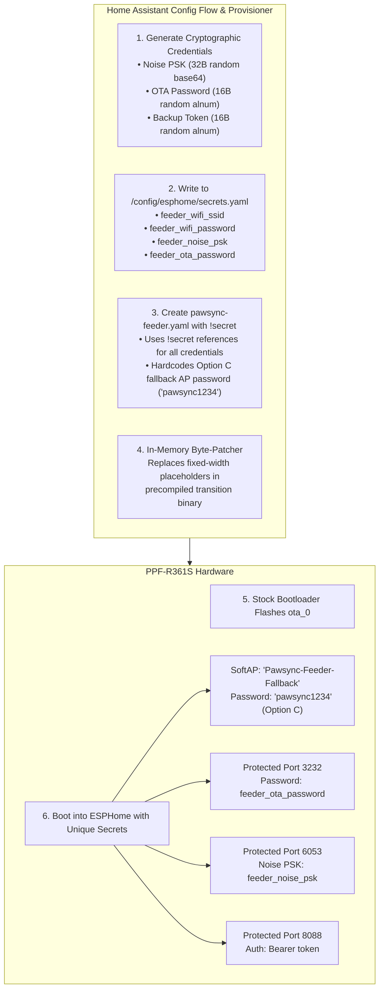

# PawSync ESPHome v1.5.0 Engineering Roadmap: Outstanding Issues & Remediation Plan

**Document Version:** 1.0.0  
**Target Release:** v1.5.0  
**Repository:** [sibero80/pawsync_esphome](https://github.com/sibero80/pawsync_esphome) | [sibero80/pawsync_ota](https://github.com/sibero80/pawsync_ota)  
**Date:** 2026-10-29  

---

## 1. Executive Summary

With the successful verification of zero-touch conversion, factory slot preservation (`ota_1`), and automated calibration backup in `v1.4.3`, the project has reached functional maturity. However, an independent forensic security audit (`last_review.md`) confirmed several outstanding security, reliability, and code-quality items that arose from prioritizing initial conversion success.

This document serves as the technical specification and implementation backlog for **v1.5.0**. The central architectural initiative is the **Device-Specific Secrets Framework**, which resolves the majority of high-severity vulnerabilities simultaneously.

---

## 2. Core Architecture: The Device-Specific Secrets Framework

The fundamental architectural weakness identified in `v1.4.3` is reliance on hardcoded transition credentials (`TRANSITION_NOISE_PSK`) and open network interfaces (unauthenticated fallback AP and OTA port).

### 2.1 The Two-Phase Credential Architecture (Binary Patching vs. ESPHome `!secret`)

A key design clarification for v1.5.0 is the duality between **Initial Flashing (Phase 1)** and **Day-2 Maintenance (Phase 2)**:

1. **Phase 1: Zero-Touch Transition (Precompiled Binary Byte-Patching)**
   - The feeder runs stock factory firmware and downloads a precompiled transition image (`pawsync_ota_update.bin`) from the integration stager.
   - Because stock firmware cannot parse ESPHome YAML, the integration dynamically byte-patches fixed-width placeholder buffers in the binary in-memory right before staging.
   - Placeholders patched: Target Wi-Fi SSID/password, Noise PSK (`PLACEHOLDER_NOISE_PSK_KEY_44B`), and OTA password.

2. **Phase 2: Ongoing ESPHome Dashboard Management (`!secret` Integration)**
   - Concurrently, the Home Assistant integration populates `/config/esphome/secrets.yaml` with the generated credentials:
     - `feeder_wifi_ssid: "..."`
     - `feeder_wifi_password: "..."`
     - `feeder_noise_psk: "..."`
     - `feeder_ota_password: "..."`
   - The feeder's ESPHome dashboard YAML (`/config/esphome/pawsync-feeder.yaml`) references these via `!secret`:
     ```yaml
     wifi:
       ssid: !secret feeder_wifi_ssid
       password: !secret feeder_wifi_password
       ap:
         ssid: "Pawsync-Feeder-Fallback"
         password: "pawsync1234" # Option C: Standard recovery password

     api:
       encryption:
         key: !secret feeder_noise_psk

     ota:
       - platform: esphome
         password: !secret feeder_ota_password
     ```
   - All subsequent OTA updates compiled directly through the ESPHome dashboard or Home Assistant Update entity naturally resolve these secrets without any binary patching.



### 2.2 Fallback AP Password Policy: Option C (Standard Recovery Password)

Under the IEEE 802.11i / WPA2-PSK standard, Wi-Fi passphrases must be **at least 8 ASCII characters** (up to 63 chars). Deriving a password directly from the user's Wi-Fi SSID (e.g. `Home` or `IoT`) causes an immediate crash in ESP-IDF's Wi-Fi stack (`ESP_ERR_WIFI_PASSWORD: passphrase < 8 chars`).

To solve this cleanly, v1.5.0 implements **Option C**:
- **SSID:** `Pawsync-Feeder-Fallback`
- **Fallback Password:** `pawsync1234` (standard, memorable, documented recovery passphrase).
- **Security Boundary & Layered Defense:**
  - The fallback SoftAP only activates when the device fails to connect to the configured primary Wi-Fi network.
  - Access to the SoftAP only exposes the captive portal for Wi-Fi reconfiguration.
  - The feeder's control surface (ESPHome Native API on port 6053) is strictly protected by the unique 32-byte per-device Noise PSK. Even if an unauthorized person connects to the fallback AP, they cannot control feeding, inspect telemetry, or tamper with the device without the Noise PSK.
  - Simplifies end-user recovery: If the router changes, users do not need to hunt through Home Assistant hidden files or flash logs for an ephemeral random AP password.

### 2.3 Direct Resolution Matrix:
Adopting this model directly resolves **6 major audit items**:
1. **H1 (Restores OTA & AP Passwords)**: Fallback AP is secured with Option C (`pawsync1234`); port 3232 requires `!secret feeder_ota_password`.
2. **H2 (Eliminates Public Noise PSK)**: Every feeder has a distinct, cryptographically random Noise key in `secrets.yaml`; zero shared keys exist.
3. **H4 (Eliminates Plaintext YAML Passwords)**: Wi-Fi credentials are saved in `/config/esphome/secrets.yaml` with `0600` permissions and referenced via `!secret`.
4. **H6 (Secures Port 8088 Backup Server)**: Backup endpoints require `Authorization: Bearer <token>`, preventing unauthorized flash dumps.
5. **M3 (Eliminates Foreign Flow Hacking)**: With secrets pre-populated in `secrets.yaml`, standard Home Assistant zeroconf discovery adopts the device natively.
6. **M4 (Sanitizes Public CI Releases)**: GitHub release binaries contain only template placeholders; zero real secrets are baked into release assets.

---

## 3. High-Priority Issues (Security & Correctness)

### H1. Restore OTA and Fallback-AP Authentication
* **Current State:** `pawsync.yaml` lines 154–161 have no password under `ota:` and `wifi.ap:`. Port 3232 and the fallback AP are completely open.
* **Remediation Plan:**
  1. **Fallback AP Authentication (Option C):** Standardize fallback AP password to `pawsync1234` in `pawsync.yaml` template. This guarantees IEEE 802.11i compliance ($\ge 8$ chars) without dynamic SSID derivation issues, while port 6053 ESPHome Native API remains fully secured by the unique per-device Noise PSK.
  2. **OTA Port 3232 Authentication:** Add `PLACEHOLDER_OTA_PASSWORD_32B` placeholder in precompiled firmware. Inject a cryptographically generated 16-character alphanumeric OTA password during staging.
  3. **Day-2 Maintenance:** Store `feeder_ota_password` in `/config/esphome/secrets.yaml` so subsequent compilations use `password: !secret feeder_ota_password`.

---

### H2. Complete Elimination of Shared `TRANSITION_NOISE_PSK`
* **Current State:** `const.py` line 58 defines a public Noise PSK that persists indefinitely on every converted device.
* **Remediation Plan:**
  1. Define a 44-byte base64 placeholder buffer `PLACEHOLDER_NOISE_PSK_KEY_44B` in `pawsync_ota`.
  2. The stager patcher replaces this buffer with `base64.b64encode(secrets.token_bytes(32)).decode('ascii')`.
  3. Deprecate and remove `TRANSITION_NOISE_PSK` fallback loops in `esphome_provisioner.py`.

---

### H3. Remove Legacy Untokenized Stager Routes & Enforce One-Shot Downloads
* **Current State:** `ota_stager.py` lines 140–143 serve `/firmware.bin` and `/pawsync_ota_update.bin` without token authentication.
* **Remediation Plan:**
  1. Delete lines 142–143 in `ota_stager.py`. Only serve the randomized UUID route `/ota/<token>/pawsync_ota_update.bin`.
  2. Implement one-shot invalidation: as soon as the feeder finishes downloading (HTTP 200 stream complete), deregister the route and shut down the HTTP server.

---

### H4. Secure Wi-Fi Credential Lifecycle on Host Storage
* **Current State:**
  1. `firmware_patcher.py` line 164 writes `pawsync_ota_customized.bin` containing Wi-Fi credentials to disk and never deletes it.
  2. `esphome_provisioner.py` lines 60–61 write plaintext Wi-Fi credentials directly into `/config/esphome/pawsync-feeder.yaml`.
* **Remediation Plan:**
  1. Delete `pawsync_ota_customized.bin` immediately in `PawsyncOtaStager.async_stop()` or within a `finally:` block after download completion.
  2. Update `generate_esphome_yaml()` to write `!secret feeder_wifi_ssid` and `!secret feeder_wifi_password`. Append these keys to `/config/esphome/secrets.yaml` with file permissions `0600`.

---

### H5. Fail-Closed Patcher Validation & Multi-Byte Safe Slicing
* **Current State:**
  - `patch_raw_esp32_credentials()` cuts inputs with `[:32]` and `[:64]`. If an SSID is exactly 32 bytes, no `\0` string terminator is preserved.
  - If placeholders are missing or patching raises an exception, it logs a warning and returns unpatched firmware (fails open).
* **Remediation Plan:**
  1. Enforce strict input limits: SSIDs truncated to max 31 bytes (`[:31] + b"\x00"`), passwords to max 63 bytes (`[:63] + b"\x00"`).
  2. Prevent UTF-8 multibyte character splitting:
     ```python
     def safe_truncate_utf8(text: str, max_bytes: int) -> bytes:
         encoded = text.encode("utf-8")
         while len(encoded) > max_bytes:
             text = text[:-1]
             encoded = text.encode("utf-8")
         return encoded + b"\x00"
     ```
  3. Fail closed: If placeholders are missing or patching encounters any error, raise `FirmwarePatchError` and abort the OTA staging process immediately.

---

### H6. Authenticate Port 8088 Backup Streaming Server
* **Current State:** `ppf_r361s.cpp` lines 1905–1927 serve `/export_stock_bin` and `/export_calibration` to any unauthenticated client on port 8088.
* **Remediation Plan:**
  1. Add an `Authorization` header check to `http_export_status_handler`, `http_export_stock_bin_handler`, and `http_export_calibration_handler`.
  2. Validate that incoming requests provide `Bearer <backup_token>` or match the pre-shared Noise PSK.
  3. Shut down the backup server automatically after successful harvest or after a 5-minute timeout.

---

### H7. Fix Missing `import tempfile` in `ota_stager.py`
* **Current State:** `ota_stager.py` line 124 calls `tempfile.gettempdir()`, but `tempfile` is not imported.
* **Remediation Plan:** Add `import tempfile` to imports in `ota_stager.py`.

---

## 4. Medium-Priority Issues (Reliability & Robustness)

| Issue ID | Description | Remediation Plan |
| :--- | :--- | :--- |
| **M1** | **Config Flow Error & Timeout Handling** | In `_async_convert_feeder_task`, check the boolean return of `async_auto_adopt_esphome`. If `False`, do not transition to `ota_finish`; display a retry/manual-IP dialog. Change `self._cloud_auth[CONF_TOKEN]` to guarded `.get()`. |
| **M2** | **Task Cancellation Lifecycle** | Track background tasks in `self._active_tasks: set[asyncio.Task]`. In `async_step_user` (or if flow is aborted/closed), cancel all pending tasks to prevent background thread leaks. |
| **M3** | **Decouple Foreign ESPHome Flow Driving** | Remove manual step injection into Home Assistant's internal `esphome` flow. Instead, rely on Home Assistant's native zeroconf discovery which reads the pre-provisioned key in `secrets.yaml`. |
| **M4** | **Sanitize CI Release Pipeline** | In `.github/workflows/release.yml`, ensure the build step compiles from a sanitized template with placeholder tokens, rather than relying on a broken `sed` replace on `secrets.yaml.example`. |
| **M5** | **Post-Patch Binary Structural Verification** | After patching in `firmware_patcher.py`, re-parse the ESP32 header magic byte (`0xE9`), verify section table offsets, and confirm placeholder absence before wrapping in the VeSync container. |
| **M6** | **Pin Transition Binary Digest** | In `firmware_downloader.py`, maintain a dictionary of release version to expected SHA-256 hash. Verify the downloaded binary against this digest before caching or executing. |
| **M7** | **Eliminate Side Effects in `sensor.async_update`** | Remove `_async_trigger_backup` from `sensor.py` line 162. Trigger factory backup during integration entry setup (`async_setup_entry`) or via a dedicated service (`pawsync.trigger_backup`). |
| **M8** | **Make CI Unit Tests Environment-Agnostic** | In `tests/test_firmware_patcher.py` line 33, replace the hardcoded path `/root/pawsync_ota/pawsync_ota_update.bin` with a dynamically generated synthetic test container so tests run and pass in GitHub Actions. |
| **M9** | **Backup Retention & Rotation Policy** | Implement retention in `backup_manager.py`: retain the pristine `stock_<mac>.bin` permanently, and rotate `cal_<mac>.bin` to keep the 3 most recent timestamps, deleting older snapshots. |
| **M10** | **Modular Refactoring of `ppf_r361s.cpp`** | Refactor the 2,130-line monolithic C++ component into modular translation units: `ppf_r361s_uart.cpp`, `ppf_r361s_backup.cpp`, `ppf_r361s_schedule.cpp`, and `ppf_r361s_sensors.cpp`. |
| **M11** | **Diagnostic Sensors for Free Heap & Sockets** | Add diagnostic sensors for `Free Heap Space` (bytes) and `Free lwIP Sockets` to monitor ESP32-C3 resource headroom under heavy network load. |
| **M12** | **Portion-Proportional Safety Motor Timeouts** | Scale motor timeout protection proportionally to portion count (e.g. `timeout = base_sec + (portions * 1.2s)`) rather than using a static constant. |

---

## 5. Low-Priority & Hygiene Items

1. **Centralize Cloud API Client Fingerprints**: Consolidate Android OS version, client version, and app IDs into a single `CLOUDPREFS` dict in `const.py`.
2. **Log Level Adjustments**: Demote routine polling logs from `INFO` to `DEBUG` in `esphome_provisioner.py` and `backup_manager.py`.
3. **Single-Source Version String**: Establish a single version source in `const.py` and generate `manifest.json` and `pawsync.yaml` versions during build/release.
4. **Publish `SECURITY.md`**: Document the threat model, local LAN security boundaries, container encryption structure, and reporting procedures.

---

## 6. Implementation Sprints


### Sprint 1: Tactical Security Hotfixes (v1.4.4)
* Fix missing `import tempfile` in `ota_stager.py`.
* Remove `/firmware.bin` and `/pawsync_ota_update.bin` legacy routes.
* Implement null-terminated UTF-8 safe slicing (`safe_truncate_utf8`) and fail-closed validation in `firmware_patcher.py`.
* Clean up `pawsync_ota_customized.bin` on disk upon stager shutdown.
* Move backup harvesting out of `sensor.async_update`.

### Sprint 2: Device-Specific Secrets Framework (v1.5.0-beta)
* Implement fixed placeholder buffers in `pawsync_ota` for PSK, OTA password, and backup token.
* Configure fallback SoftAP with Option C recovery password (`pawsync1234`).
* Update `config_flow.py` to generate cryptographically random keys per device.
* Append device secrets (`feeder_wifi_ssid`, `feeder_wifi_password`, `feeder_noise_psk`, `feeder_ota_password`) to `/config/esphome/secrets.yaml` with `0600` permissions.
* Update `generate_esphome_yaml()` to use `!secret` references.
* Require `Authorization: Bearer <token>` on port 8088 in `ppf_r361s.cpp`.

### Sprint 3: Architectural Maturation & Quality Gates (v1.5.0-final)
* Add post-patch ELF / image segment table parser in `firmware_patcher.py`.
* Pin SHA-256 digests in `firmware_downloader.py`.
* Split `ppf_r361s.cpp` into focused translation units.
* Add synthetic test containers in `test_firmware_patcher.py` for CI execution.
* Add heap and socket diagnostics in `pawsync.yaml`.
* Publish `SECURITY.md`.
